# KINGS OF DAWN – Projektauftrag & Codex-Prompts

Stand: 25.11.2026 · Version 1.3. Unreal Engine 5 ist verbindlich; Rust ist die bevorzugte Core-Sprache. Arbeitstitel und Phasen sind Planungsannahmen. Alle 42 High-Fidelity-Mockups sind in diesem Dokument eingebettet und im HTML-Projektauftrag referenziert.

High-Fidelity-Referenz: Die 42 Bildschirme sind aus der freigegebenen Konzeptgrafik abgeleitete, statische UI-Kompositionen mit gemeinsamer Kartenbasis, HUD, Outliner, Navigation und modulspezifischen Controls. Sie sind verbindliche Layoutreferenzen für UMG/Slate, keine laufende Unreal-Anwendung; die Karte ist Konzeptgrafik, keine historische GIS-Quelle. Zahlen und historische Institutionen sind beispielhaft. Schrift, Texturen, exakte Geometrie und Kartenlayer werden in Unreal nachgebaut und separat geprüft.

## Projektauftrag

### Projektziel

Eine global spielbare, fortlaufende Simulation von 100 v. Chr. bis zum aktuellen Kalenderjahr als Startdatum, danach offene alternative Entwicklung. Spieler übernehmen Staaten oder definierte Rollen, Beobachter sehen einer autonomen Welt zu. Zielgruppe: Strategie- und Geschichtsfans, Modder, Sandbox-Spieler. Kein vorgegebenes Siegesziel; optional eigene Missionsziele.

### Auftrag & Abgrenzung

Auftraggeber: noch festzulegen. Projektleitung, Teamgröße, Budget, Fixtermine und Lizenz-/Vertriebsmodell: offen. Dieser Auftrag ist ein Soll-Konzept, kein bereits implementiertes Spiel. Desktop zuerst (Windows/Linux/macOS als Ziel); Singleplayer offline zuerst. Keine vollständige 3D-Stadt- oder Schlachtfeldsimulation, keine historischen Tagesdaten für jede Region versprochen, kein echtes Geld oder reale Finanztransaktionen. Startdatum ist begrenzt, Enddatum nicht. Raumfahrt/außerirdische Kolonien sind eine optionale spätere Erweiterung.

### Kernablauf

Startjahr → Datenqualität und Weltzustand prüfen → Land/Rolle wählen oder Staat gründen → Ziele, Haushalt und Gesetze bearbeiten → Zeit laufen lassen → Ereignisse und Folgen analysieren → reagieren → speichern. Der Beobachtermodus nutzt dieselbe Engine ohne Spielercommands. Sandbox erlaubt direkte Änderungen, Realismusmodus verlangt institutionelle und wirtschaftliche Voraussetzungen.

### Verbindliche technische Architektur · Unreal Engine 5 + Rust

**Verbindliche Engine und Sprachwahl**

Unreal Engine 5 (UE5) ist die verbindliche Hauptengine für KINGS OF DAWN. Eine stabile UE5-Version wird in M0 ausgewählt und festgeschrieben. Rust ist die bevorzugte und primäre Sprache für den deterministischen Simulationskern mit getrennten Crates (world, economy, society, government, diplomacy, military, history, persistence, ai). Unreal-Integration, Rendering, Eingaben, Engine-Lifecycle, UI und plattformspezifische Funktionen werden in C++ mit Unreal APIs umgesetzt; UMG/Slate für das moderne HOI4-inspirierte Interface, Blueprints nur für Präsentation und geeignete Editor-Workflows. Keine doppelte Fachlogik in C++ oder Blueprints. Rust ist keine nativ unterstützte Unreal-Gameplay-Sprache; keine Abhängigkeit von einem ungewarteten Rust-Gameplay-Plugin voraussetzen.

**Rust–Unreal-Integration**

Ein eigenes Unreal-Plugin KingsOfDawnSimulation bindet die Rust-Bibliothek über eine versionierte C-ABI (extern "C", repr(C), generierte Header via cbindgen) in UnrealBuildTool/Build.cs ein. Bevorzugt Cargo staticlib, cdylib nur bei begründetem Bedarf. Opaque Handles, explizite Eigentums- und Freigaberegeln, keine Rust-Container oder UObject-Zeiger über die ABI, keine Panics oder C++-Exceptions über Sprachgrenzen. Explizite Fehlercodes und ABI-Version prüfen. Ein C++-Subsystem verwaltet den Lebenszyklus. Simulation auf einem dedizierten Worker mit atomarer Command-Queue; immutable, gebündelte Snapshots/Deltas an den Game Thread, keine UObject-Zugriffe aus Rust oder Hintergrundthreads. UI und Renderer sind Konsumenten, der Rust-Core ist einzige autoritative Zustandsquelle.

**Kartenrendering und Assets**

UE5 rendert die interaktive politische Weltkarte aus offline vorbereiteten Geodaten: georeferenzierte, gekachelte Meshes, LOD, Culling, GPU-basierte politische Einfärbung und Auswahl über stabile Zell-IDs; sichtbare Grenzen, Gelände, Straßen, Symbole und Kartenmodi als separate Layer. GeoJSON/GeoPackage dienen als Importformate; Vektortiles können als internes Import-/Cacheformat dienen, nicht als WebGL-Frontend. Keine Actor-Instanz pro Zelle im Vollausbau. Geeignete UE-Materialien, Texturen, Instancing und Streaming nach Benchmark. Slate/UMG-Widgets nutzen virtualisierte Listen und ereignisbasierte Updates. Die HTML-Mockups sind reine Designreferenzen, keine Laufzeittechnologie.

**Build, Datenhaltung und Abnahme**

Repository: Unreal-Projekt (.uproject, Source/, Content/, Config/, Plugins/KingsOfDawnSimulation/) sowie rust/ als Cargo-Workspace mit core, ffi, atlas-cli und headless-runner. SQLite für lokale Metadaten/Saves, komprimierte binäre Snapshots, versionsgebundene Datenschemata. Rust-Core muss ohne UE oder Remote-LLM ausführbar und testbar sein. M0-Spike: Cargo-Build je Zielplattform, UE-Build.cs-Linking, verpackter Windows-Build mit FFI-Roundtrip und reproduzierbarem Save/Load, Worker-Lifecycle, 10.000-Zellen-Kartenprototyp, Headless-Replay-Hash und Fehlerpfade; Linux/macOS-Builds separat verifizieren. Unreal Engine bleibt verbindlich; Linkage, Kartenpipeline und konkrete Engine-Version nach Messung festlegen. Rust bleibt bevorzugt; C++-Ausnahmen für den Core nur nach dokumentiertem technischen Blocker und Architekturentscheidung. Unreal-Lizenzbedingungen und Drittanbieter-Lizenzen vor Vertrieb prüfen.

Technische Referenzen: [Epic: Third-Party Libraries in Unreal Engine](https://dev.epicgames.com/documentation/en-us/unreal-engine/integrating-third-party-libraries-into-unreal-engine) · [Epic: Slate in Unreal Engine](https://dev.epicgames.com/documentation/en-us/unreal-engine/using-slate-in-a-project-in-unreal-engine) · [Rustonomicon: FFI](https://doc.rust-lang.org/stable/nomicon/ffi.html) · [Rust Reference: Linkage](https://doc.rust-lang.org/stable/reference/linkage.html)

### Simulationsvertrag

Commands werden autorisiert, validiert, in stabiler Reihenfolge atomar angewandt und als Events protokolliert. Tickfolge: fällige Regeln/Events → Demografie/Arbeitsangebot → Produktion → Handel/Bestände → Preise/FX → Buchungen/Budget → Versorgung/Konflikte → politische Stimmung/KI → Statistik/Snapshot. KI plant für den nächsten Tick. Simulationszeit: tägliche Ereignisse, wöchentliche/monatliche Wirtschaft, jährliche Demografie mit unterjähriger Verteilung. Keine Abhängigkeit von Render-FPS oder Wandzeit. Seed, sortierte IDs, Fixed-Point-Werte, definierte Rundung und State-Hash sichern Reproduzierbarkeit.

### Karten- und Zeitmodell

Interne Datumsdarstellung astronomisch: 100 v. Chr. = -99, 1 v. Chr. = 0, 1 n. Chr. = 1; Jahr 0 niemals in der Anzeige. Historische Quelljahre explizit konvertieren, keine pauschale Interpretation negativer Zahlen. Intervalle [validFrom, validTo), Granularität und Kalendersystem speichern; Default 1. Januar pro Jahr im proleptischen Kalender, nicht als gesicherter historischer Stichtag ausgeben. Basiszellen mit stabilen IDs und Adjazenz; Provinzen sind veränderbare Gruppen. Kontrolle, Verwaltung, Anspruch und Souveränität als getrennte Beziehungen. Unbekannt ist nicht unbewohnt. Historische Küstenveränderungen separat; topologische Fehler beheben und protokollieren.

### Wirtschaftsmodell

Warenbestand nächster Tick = Bestand + Produktion + Import − Konsum − Export − Verlust. Produktion begrenzt durch Kapazität, Arbeit, Energie und Inputs. Preise reagieren gedämpft auf Nachfrage/Angebot und Lagerquote, mit positiven Grenzen und Transaktionskosten. Geldbeträge als Fixed-Point, Buchungen in Kontowährung, FX-Differenzen separat; Geldschöpfung nur über explizite Bilanztransaktionen. Wechselkurse aus Zahlungsströmen, Inflationserwartung, Vertrauen und Reserven, nicht aus beliebigen BIP-Prozentboni; Referenzkorb pro Epoche, moderne EUR-Anzeige nur optional. Nominal-/Realwerte und Kaufkraft trennen. Keine 1:1-Vorhersage realer Wechselkurse.

### Gesellschaft & Politik

Kohorten statt einzelner Milliarden Einwohner; einzelne Personen nur für relevante Rollen. Kohortenbilanz: Bevölkerung + Geburten − Todesfälle + Zuzug − Wegzug. Gesetzes-DSL enthält Parameter, Typ, Geltungsbereich, Datum und Durchsetzung; Effekte über Domainregeln. Institutionen bestimmen rechtliche Kompetenzen, Verwaltungskapazität bestimmt Umsetzung. Politische Zustimmung aus Lebensbedingungen, Interessen und Ereignissen; keine pauschale Bewertung von Kultur/Religion.

### Epochenmodell

Epochenpakete definieren verfügbare Institutionen, Währungen, Einheiten, Transport, Produktion, Rechtsformen und Technologien. Antike: Tausch-/Metallgeld, Landwirtschaft, historische Stadt-/Herrschaftsformen; Mittelalter: Feudalstrukturen, regionale Märkte; frühe Neuzeit: Handelsnetze und Staatenbildung; Industriezeit: Fabriken, Schienen, Massenpolitik; Moderne: Zentralbanken, komplexe Lieferketten, moderne Institutionen. Technologie ist Voraussetzung, kein hartes Kalenderjahr; historischer Start hat epochenplausible Ausstattung.

### UI/UX & Designsystem

Eigenständige dunkle Atlas-Ästhetik: Hintergrund #101820, Panels #182630, Akzent #D4AA65, Text #E5E9E6; Kartenfarben getrennt von Statusfarben, Muster bei Konflikten. Oben Zeit/Kernwerte, links Hauptnavigation, mittig Karten-/Arbeitsfläche, rechts Kontextinspektor, unten Ereignisse. 1080p als Mindestziel, skalierbare Panels, Tastaturfokus, klare Einheiten, Tooltips mit Berechnungsgrundlage. Alle nachstehenden Mockups sind schematische UI-Wireframes mit fiktiven Werten, keine fertigen Grafikassets oder historischen Karten.

### Datenhaltung & Schnittstellen

Stabile UUIDs/IDs; EntityRef statt Namensschlüssel; Schema-Version und Migration pro Save; source_id, validity, confidence, geometry_hash für historische Daten. Commands z. B. FoundPolity, EnactLaw, BuildFacility, SetMonetaryPolicy. Queries liefern read-only ViewModels; Domain-Events wie LawEnacted, TradeSettled, BorderChanged. Kein UI-Schreibzugriff direkt auf Datenbank. Speichern atomar, Prüfsummen, rotierende Backups, Fehlerdialog ohne Datenverlust.

### Qualität & Performance

Zielwerte, noch durch Benchmarks zu bestätigen: 60 FPS bei Karteninteraktion auf Referenz-PC, p95 UI-Antwort <100 ms, MVP mit mindestens 20 autonomen Teststaaten und 10.000 Zellen; Vollausbau-Ziel 100.000+ Zellen, mehrere hundert Polities, Kohorten aggregiert. Benchmarkprofil und Hardware dokumentieren. 100 Jahre Headless-Lauf ohne negative Bestände, ungültige Eigentümer, NaN oder Buchungsfehler; Speicher- und Ladezeit messen. Unit-, Property-, Integration-, Snapshot-, Replay-, Karten- und End-to-End-Tests; feste Testseeds und CI.

### Risiken und Gegenmaßnahmen

Historische Quellenlücken → datierte Näherung, regionale Unsicherheiten, Quellenregister; Kartenlizenz → allowlist und gesonderte Datenpakete; Systemkomplexität → vertikaler MVP, Featureflags, keine ungetesteten Massenmodule; Performance → Kohorten, inkrementelle Updates, LOD und Benchmarks; Balancing → deterministische Szenarien und Telemetrie lokal/opt-in; Multiplayer → erst nach stabiler Replay-Engine. Historische Darstellungen müssen zwischen Fakten, Schätzungen und alternativer Spielgeschichte unterscheiden.

### Meilensteine und Abnahme

M0: UE5-Projekt, Cargo-Workspace, KingsOfDawnSimulation-Plugin, C-ABI, verpackter Build, FFI-/Threading-/Replay-Tests, ADRs, Domain-/Save-Schema, CI, Kartenprototyp und Daten-Lizenzspike. M1: Startjahr/Atlas, Zellen, Staaten, UI, Clock, Save, historische Teststände. M2: MVP mit Stadtbau, Bevölkerung, Waren, Ledger, Währung, Gesetzen und autonomen Staaten. M3: V1 mit Diplomatie, Krieg, Kultur, Forschung, Events und Modding. M4: V2 Multiplayer und Stabilisierung. Kein Fixtermin ohne Team-/Aufwandsplanung; Reihenfolge nach Abhängigkeiten, zyklische Modulkopplungen zunächst als Schnittstellenstub lösen. Abnahme durch Demo, Tests, Quellenmanifest, Performancebericht, offene Risiken und reproduzierbaren Build.

## Historische Karten

Für jedes Jahrhundert: automatisiert die aktuellste lizenzgeeignete Version der globalen Geodaten und zusätzliche regionale Quellen recherchieren; Quellenstand, Abrufdatum, Datenzeitstand, Abdeckung, Auflösung, Lizenz, Prüfsumme und Konflikte erfassen. Einen Weltkarten-Referenzstand am Jahrhundertbeginn erzeugen; zusätzliche relevante Grenzwechsel und alle verfügbaren Jahresstände importieren. Für jedes gewünschte Jahr gültige territoriale Aussagen auswählen; wenn nur benachbarte Stände existieren, letzten belegten Stand nur als Näherung anzeigen, niemals Grenzen linear interpolieren oder exakte Jahresgenauigkeit vortäuschen. Regionale datierte Belege priorisieren, widersprüchliche Aussagen parallel speichern, tatsächliche Kontrolle vs. Anspruch getrennt visualisieren. Für 2025 bis zum jeweils aktuellen Kalenderjahr aktuelle Karten mit datierten amtlichen/seriösen Quellen für Veränderungen ergänzen. Import in Quarantäne → Lizenzprüfung → Zeit-/Koordinatennormalisierung (EPSG:4326) → Geometrievalidierung/Antimeridian → stabile IDs/Topologie → Quellen-/Konfliktprüfung → Offline-Tiles/Index → visuelle und automatisierte QA → versionierte Veröffentlichung. Updates nie still in laufende Saves einspielen. Die Matrix ist ein Recherche- und Integrationsplan, keine bereits erzeugte oder verifizierte Sammlung von 22 Weltkarten. Ein tatsächlicher Download/Import ist Implementierungsarbeit.

### Quellen

- A: [Cliopatria v0.2.2](https://zenodo.org/records/24518977) – 25.11.2026; weltweit historische Polities, Referenzreichweite 3400 v. Chr.–2024 n. Chr.; neueste gefundene Version, frame years bleiben Einschränkung. CC BY 4.0 für Basissatz; konkrete Release-Dateien/Unterquellen vor Import prüfen.

- B: [Historical Basemaps](https://github.com/aourednik/historical-basemaps) – Historische GeoJSON-Zeitstände, Sekundärvergleich; GPL-3.0 und Ursprungsquellen prüfen, Datenpaket getrennt halten oder bei inkompatibler Distribution ausschließen.

- C: [OpenHistoricalMap](https://www.openhistoricalmap.org/copyright) – Datierte regionale Geometrien, Straßen, Städte und Gebäude; grundsätzlich CC0, Ausnahmen pro Objekt; keine lückenlose globale Jahresabdeckung.

- D: [CShapes 2.0](https://icr.ethz.ch/data/cshapes/) – 1886–2019 weltweit; Europa ab 1816; wissenschaftlicher Vergleich, nicht kommerziell ohne passende Rechte; nicht als Standardasset ausliefern.

- E: [Natural Earth Admin 0](https://www.naturalearthdata.com/downloads/10m-cultural-vectors/10m-admin-0-countries/) – Moderne politische Basiskarte, Länderdatei Version 5.1.1 laut Seite; Public Domain. Nicht automatisch ein tagesaktueller Grenzstand. Umstrittene Gebiete gesondert.

- F: [geoBoundaries](https://www.geoboundaries.org/) – Aktuelle administrative Ebenen; gbOpen und einzelne Metadaten/Lizenzen prüfen, CC BY 4.0 als allgemeine Angabe; nicht auf frühere Jahrhunderte übertragen.

- G: [Cliopatria Fachartikel](https://www.nature.com/articles/s41597-025-04516-9) – Methodik, Grenzen der historischen Rekonstruktion und Validierung; kein Ersatz für Primärquellen.

- H: [Natural Earth Grenzpolitik](https://www.naturalearthdata.com/about/disputed-boundaries-policy/) – De facto, de jure und unterschiedliche Sichtweisen; kartografische Entscheidung dokumentieren.

### Jahrhundertmatrix

| Zeitfenster | Referenzjahr | Quellen | Status |

|---|---|---|---|

| 100–1 v. Chr. | 100 v. Chr. | A, B, C, G | Import & QA offen |

| 1–100 n. Chr. | 1 n. Chr. | A, B, C, G | Import & QA offen |

| 101–200 n. Chr. | 101 n. Chr. | A, B, C, G | Import & QA offen |

| 201–300 n. Chr. | 201 n. Chr. | A, B, C, G | Import & QA offen |

| 301–400 n. Chr. | 301 n. Chr. | A, B, C, G | Import & QA offen |

| 401–500 n. Chr. | 401 n. Chr. | A, B, C, G | Import & QA offen |

| 501–600 n. Chr. | 501 n. Chr. | A, B, C, G | Import & QA offen |

| 601–700 n. Chr. | 601 n. Chr. | A, B, C, G | Import & QA offen |

| 701–800 n. Chr. | 701 n. Chr. | A, B, C, G | Import & QA offen |

| 801–900 n. Chr. | 801 n. Chr. | A, B, C, G | Import & QA offen |

| 901–1000 n. Chr. | 901 n. Chr. | A, B, C, G | Import & QA offen |

| 1001–1100 n. Chr. | 1001 n. Chr. | A, B, C, G | Import & QA offen |

| 1101–1200 n. Chr. | 1101 n. Chr. | A, B, C, G | Import & QA offen |

| 1201–1300 n. Chr. | 1201 n. Chr. | A, B, C, G | Import & QA offen |

| 1301–1400 n. Chr. | 1301 n. Chr. | A, B, C, G | Import & QA offen |

| 1401–1500 n. Chr. | 1401 n. Chr. | A, B, C, G | Import & QA offen |

| 1501–1600 n. Chr. | 1501 n. Chr. | A, B, C, G | Import & QA offen |

| 1601–1700 n. Chr. | 1601 n. Chr. | A, B, C, G | Import & QA offen |

| 1701–1800 n. Chr. | 1701 n. Chr. | A, B, C, G | Import & QA offen |

| 1801–1900 n. Chr. | 1801 n. Chr. | A, B, C, D, G | Import & QA offen |

| 1901–2000 n. Chr. | 1901 n. Chr. | A, B, C, D, G | Import & QA offen |

| 2001–heute | 2001 + 2024 + aktueller Stand | A, C, D, E, F, H | Import & QA offen |

## Masterprompt

Du bist Lead Engineer, Game Designer und QA-Verantwortlicher für KINGS OF DAWN (Arbeitstitel). Entwickle eine modulare Desktop-Grand-Strategy-Simulation gemäß diesem Projektauftrag. Implementiere zuerst den vertikalen MVP, anschließend V1 und V2 in Abhängigkeitsreihenfolge. Jede Änderung muss eine echte Domain-Funktion sein, nicht nur ein UI-Dummy. Verwende eine deterministische Simulationsengine, typisierte Commands und Domain-Events, versionierte Szenario-/Save-/Mod-Schemata und eine getrennte UI. Unreal Engine 5 ist verbindlich. Implementiere die autoritative Fachsimulation bevorzugt in Rust (Cargo-Workspace), die Engine-Integration und das Rendering in Unreal C++ sowie die UI in UMG/Slate. Kopple beide Schichten über das eigene KingsOfDawnSimulation-Plugin mit versionierter C-ABI. Kein Tauri-, React- oder WebGL-Laufzeitfrontend. Beginne mit dem M0-Integrationsspike und bestätige die Build-, Threading-, FFI- und Packaging-Anforderungen vor dem weiteren Ausbau. Verwende ausschließlich zulässige, dokumentierte Quellen und Assets. Stelle historische Unsicherheit ausdrücklich dar und verhindere anachronistische Mechaniken im historischen Modus. Lege vor jedem Modul Architekturentscheidungen, Datenmodell, Schnittstellen und Tests fest; setze dann die Oberfläche anhand des Mockups um. Liefere pro Modul Code, Migrationen, Fixtures, Unit-/Integrations-/UI-Tests, Dokumentation, reproduzierbare Demo und einen Bericht zu offenen Punkten. Keine stillen Platzhalter, keine erfundenen historischen Fakten, keine Lizenzverletzungen. Bestehende Tests müssen weiterhin bestehen. Bei fehlenden Daten: unknown/estimated kennzeichnen, nicht Null erfinden. Halte die UI reaktionsfähig und alle Aktionen nachvollziehbar. Arbeite in kleinen überprüfbaren Commits; keine parallelen Schreibzugriffe auf den Simulationszustand.

## Module

### F-01 – Startjahr und Szenarien (MVP)

Jahreswahl von 100 v. Chr. bis aktuellem Kalenderjahr; historische Kampagne, alternative Geschichte, frei konfigurierbare Sandbox; Staat auswählen und Quellenstand sehen.

**Datenmodell:** Scenario, HistoricalDate, Bookmark, DatasetVersion

**UI-Mockup-Referenz:** HTML, F-01; Elemente: Zeitwahl: 100 v. Chr. / 1 n. Chr. / 476 / 1066 / 1492 / 1815 / 1914 / 1936 / heute; Länderwahl; Datengüte

**Abnahme:** 1 v. Chr. springt auf 1 n. Chr.; jedes erlaubte Jahr liefert einen initialisierbaren Zustand; fehlende Daten sichtbar; ausgewählte Quelle bleibt im Save fixiert.

**Prompt:**

Setze das Modul 01 – Startjahr und Szenarien für KINGS OF DAWN um. Phase: MVP. Verwende den globalen Projektauftrag und die gemeinsame Architektur. Nutze die zugehörige High-Fidelity-Referenz als verbindliche visuelle Basis: feste HUD-Positionen, gleiche Kartenkamera, Messingrahmen und dunkle Stahlpanels, seitlicher Outliner, Minikarte, modulspezifische Controls; implementiere skalierbare UMG/Slate-Komponenten, keine bloße Screenshot-Oberfläche. Nutze verbindlich UE5; implementiere die Fachlogik bevorzugt im Rust-Core, die erforderlichen Engine-Adapter in C++ und die Oberfläche in UMG/Slate. Nutze das KingsOfDawnSimulation-Plugin und die versionierte C-ABI mit Commands und Snapshot-/Delta-Queries. Rein präsentationsbezogene Funktionen bleiben in Unreal; dupliziere keine Simulationslogik. Ergänze Rust-Tests und bei UE-Integration Unreal-Automation-Tests. Die Oberfläche und alle ViewModels müssen die definierte Designrichtung "modernes HOI4" einhalten: dunkle Grand-Strategy-Panels, Kartenfokus, obere Statusleisten, Seiteninspektoren, warme Metall-/Goldakzente, hohe Informationsdichte und zugleich modernisierte Lesbarkeit sowie UX. Fachlicher Umfang: Jahreswahl von 100 v. Chr. bis aktuellem Kalenderjahr; historische Kampagne, alternative Geschichte, frei konfigurierbare Sandbox; Staat auswählen und Quellenstand sehen. Datenmodell: Scenario, HistoricalDate, Bookmark, DatasetVersion. Baue die Oberfläche nach dem zugehörigen Mockup mit folgenden Bedienelementen: Zeitwahl: 100 v. Chr. / 1 n. Chr. / 476 / 1066 / 1492 / 1815 / 1914 / 1936 / heute; Länderwahl; Datengüte. Abhängigkeiten: 02. Definiere typisierte Commands, read-only Queries, Domain-Events, Validierung, Transaktionen und Fehler-/Leerzustände. Implementiere die Funktion im Simulationskern und verbinde sie mit der UI; keine rein visuellen Platzhalter. Prüfe Epochenregeln, Realismus-/Sandbox-Berechtigungen und Save-Kompatibilität, soweit relevant. Abnahme: 1 v. Chr. springt auf 1 n. Chr.; jedes erlaubte Jahr liefert einen initialisierbaren Zustand; fehlende Daten sichtbar; ausgewählte Quelle bleibt im Save fixiert. Liefere Unit- und Integrationstests, UI-Smoke-Test, Seed-Fixture, Dokumentation und eine kurze Liste der verbleibenden Einschränkungen. Implementiere YearPicker und ScenarioResolver getrennt; Testmatrix für 100 v. Chr., 1 v. Chr., 1 n. Chr., 476, 1492, 1914, 1936 und aktuelles Jahr.

### F-02 – Historischer Atlas und Kartenimport (MVP)

Zeitabhängige Grenzen, Quellenvergleich, Datensatzregister, historische Küstenlinien soweit verfügbar; de facto und de jure getrennt, unsichere Gebiete schraffiert; Jahrhundert-Referenzkarten und Jahreszustände.

**Datenmodell:** SourceManifest, PolityAssertion, BorderVersion, SpatialCell, ValidityInterval

**UI-Mockup-Referenz:** HTML, F-02; Elemente: Jahr 476; Quellen: Cliopatria, OHM; Genauigkeit: Jahr / Jahrhundert; Layer: Herrschaft / Anspruch; Import prüfen

**Abnahme:** 22 Jahrhundertintervalle plus aktuelles Jahr geprüft; Geometrien valide; keine stille Interpolation; Grenzen lassen sich auf Herkunft zurückführen; fehlende Abdeckung ist explizit.

**Prompt:**

Setze das Modul 02 – Historischer Atlas und Kartenimport für KINGS OF DAWN um. Phase: MVP. Verwende den globalen Projektauftrag und die gemeinsame Architektur. Nutze die zugehörige High-Fidelity-Referenz als verbindliche visuelle Basis: feste HUD-Positionen, gleiche Kartenkamera, Messingrahmen und dunkle Stahlpanels, seitlicher Outliner, Minikarte, modulspezifische Controls; implementiere skalierbare UMG/Slate-Komponenten, keine bloße Screenshot-Oberfläche. Nutze verbindlich UE5; implementiere die Fachlogik bevorzugt im Rust-Core, die erforderlichen Engine-Adapter in C++ und die Oberfläche in UMG/Slate. Nutze das KingsOfDawnSimulation-Plugin und die versionierte C-ABI mit Commands und Snapshot-/Delta-Queries. Rein präsentationsbezogene Funktionen bleiben in Unreal; dupliziere keine Simulationslogik. Ergänze Rust-Tests und bei UE-Integration Unreal-Automation-Tests. Die Oberfläche und alle ViewModels müssen die definierte Designrichtung "modernes HOI4" einhalten: dunkle Grand-Strategy-Panels, Kartenfokus, obere Statusleisten, Seiteninspektoren, warme Metall-/Goldakzente, hohe Informationsdichte und zugleich modernisierte Lesbarkeit sowie UX. Fachlicher Umfang: Zeitabhängige Grenzen, Quellenvergleich, Datensatzregister, historische Küstenlinien soweit verfügbar; de facto und de jure getrennt, unsichere Gebiete schraffiert; Jahrhundert-Referenzkarten und Jahreszustände. Datenmodell: SourceManifest, PolityAssertion, BorderVersion, SpatialCell, ValidityInterval. Baue die Oberfläche nach dem zugehörigen Mockup mit folgenden Bedienelementen: Jahr 476; Quellen: Cliopatria, OHM; Genauigkeit: Jahr / Jahrhundert; Layer: Herrschaft / Anspruch; Import prüfen. Abhängigkeiten: 01. Definiere typisierte Commands, read-only Queries, Domain-Events, Validierung, Transaktionen und Fehler-/Leerzustände. Implementiere die Funktion im Simulationskern und verbinde sie mit der UI; keine rein visuellen Platzhalter. Prüfe Epochenregeln, Realismus-/Sandbox-Berechtigungen und Save-Kompatibilität, soweit relevant. Abnahme: 22 Jahrhundertintervalle plus aktuelles Jahr geprüft; Geometrien valide; keine stille Interpolation; Grenzen lassen sich auf Herkunft zurückführen; fehlende Abdeckung ist explizit. Liefere Unit- und Integrationstests, UI-Smoke-Test, Seed-Fixture, Dokumentation und eine kurze Liste der verbleibenden Einschränkungen. Beginne mit dem Quellenregister und Jahrhundertmatrix in diesem Auftrag. Erzeuge ein CLI import-atlas --source --version --year; erhalte Originaldateien unverändert; schreibe Lizenz- und Abdeckungsreport sowie Golden-GeoJSON-Testfixtures.

### F-03 – Weltkarte und Kartenmodi (MVP)

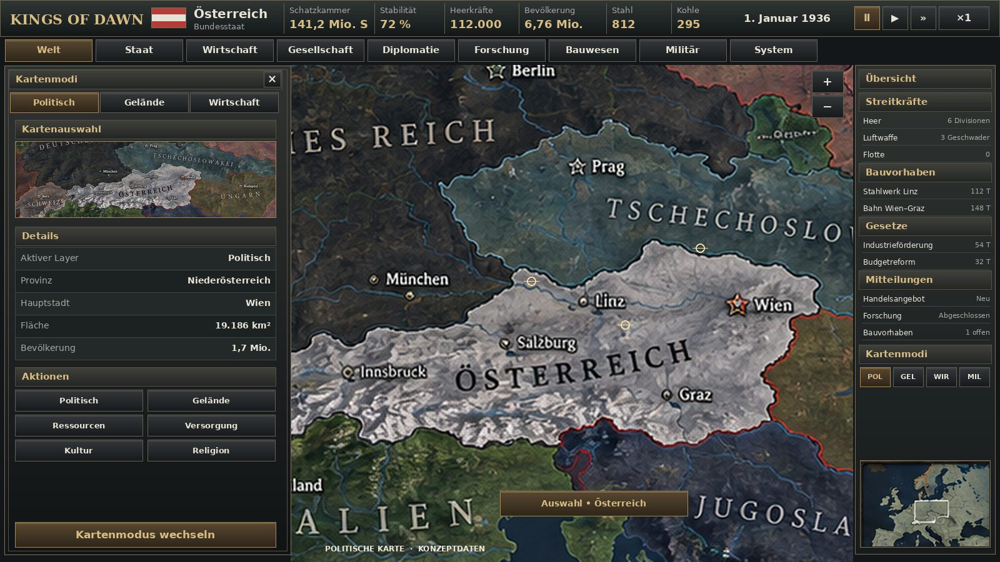

Zoom, Pan, Auswahl, Tooltips, Suchfunktion; politische, Gelände-, Bevölkerungs-, Wirtschafts-, Ressourcen-, Versorgungs-, Kultur-, Religions-, Klima- und Militärlayer; Kartenlegenden und Filter.

**Datenmodell:** MapLayer, TileIndex, Cell, FeatureSelection

**UI-Mockup-Referenz:** HTML, F-03; Elemente: Politisch; Wirtschaft; Bevölkerung; Ressourcen; Versorgung; Legende; Provinzinfo

**Abnahme:** Klick und Suche finden dieselbe Entität; Layerwechsel ändert nicht Simulationsdaten; Antimeridian und Inseln korrekt; LOD bei Zoom.

**Prompt:**

Setze das Modul 03 – Weltkarte und Kartenmodi für KINGS OF DAWN um. Phase: MVP. Verwende den globalen Projektauftrag und die gemeinsame Architektur. Nutze die zugehörige High-Fidelity-Referenz als verbindliche visuelle Basis: feste HUD-Positionen, gleiche Kartenkamera, Messingrahmen und dunkle Stahlpanels, seitlicher Outliner, Minikarte, modulspezifische Controls; implementiere skalierbare UMG/Slate-Komponenten, keine bloße Screenshot-Oberfläche. Nutze verbindlich UE5; implementiere die Fachlogik bevorzugt im Rust-Core, die erforderlichen Engine-Adapter in C++ und die Oberfläche in UMG/Slate. Nutze das KingsOfDawnSimulation-Plugin und die versionierte C-ABI mit Commands und Snapshot-/Delta-Queries. Rein präsentationsbezogene Funktionen bleiben in Unreal; dupliziere keine Simulationslogik. Ergänze Rust-Tests und bei UE-Integration Unreal-Automation-Tests. Die Oberfläche und alle ViewModels müssen die definierte Designrichtung "modernes HOI4" einhalten: dunkle Grand-Strategy-Panels, Kartenfokus, obere Statusleisten, Seiteninspektoren, warme Metall-/Goldakzente, hohe Informationsdichte und zugleich modernisierte Lesbarkeit sowie UX. Fachlicher Umfang: Zoom, Pan, Auswahl, Tooltips, Suchfunktion; politische, Gelände-, Bevölkerungs-, Wirtschafts-, Ressourcen-, Versorgungs-, Kultur-, Religions-, Klima- und Militärlayer; Kartenlegenden und Filter. Datenmodell: MapLayer, TileIndex, Cell, FeatureSelection. Baue die Oberfläche nach dem zugehörigen Mockup mit folgenden Bedienelementen: Politisch; Wirtschaft; Bevölkerung; Ressourcen; Versorgung; Legende; Provinzinfo. Abhängigkeiten: 02. Definiere typisierte Commands, read-only Queries, Domain-Events, Validierung, Transaktionen und Fehler-/Leerzustände. Implementiere die Funktion im Simulationskern und verbinde sie mit der UI; keine rein visuellen Platzhalter. Prüfe Epochenregeln, Realismus-/Sandbox-Berechtigungen und Save-Kompatibilität, soweit relevant. Abnahme: Klick und Suche finden dieselbe Entität; Layerwechsel ändert nicht Simulationsdaten; Antimeridian und Inseln korrekt; LOD bei Zoom. Liefere Unit- und Integrationstests, UI-Smoke-Test, Seed-Fixture, Dokumentation und eine kurze Liste der verbleibenden Einschränkungen. 

### F-04 – Geografie- und Provinzeditor (MVP)

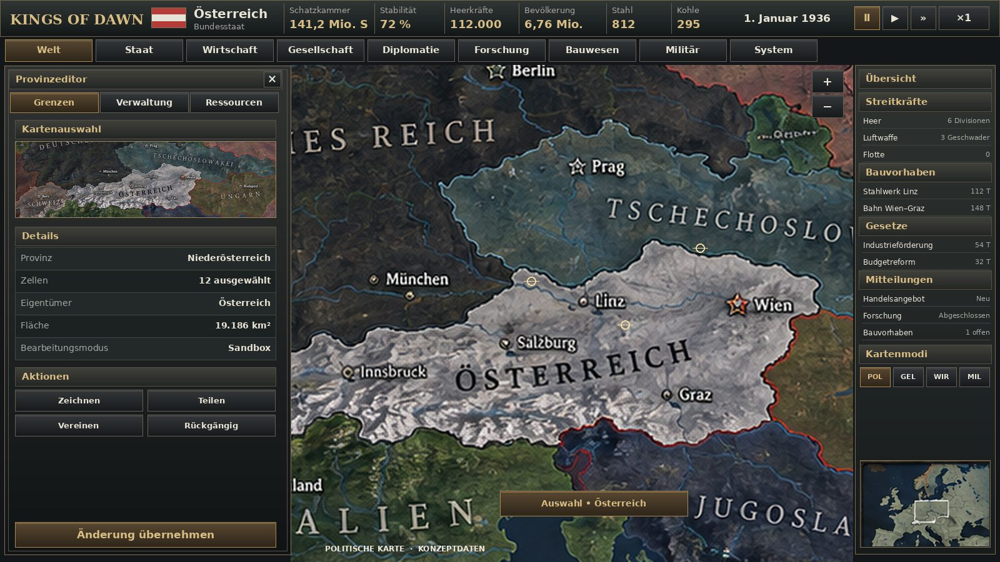

Zellen zu Provinzen, Bezirken und Gemeinden zusammenfassen, teilen und umbenennen; Grenzen zeichnen; optional eigene Kontinente, Flüsse, Gelände und Ressourcen in Sandbox.

**Datenmodell:** Province, District, CellOwnership, Terrain, ResourceDeposit, EditTransaction

**UI-Mockup-Referenz:** HTML, F-04; Elemente: Grenzen zeichnen; Zellen 12; Eigentümer; Gebiet teilen; Rückgängig; Vorschau

**Abnahme:** Jede Landzelle hat genau eine administrative Zuordnung oder Status unbekannt; Split/Merge erhält Bevölkerung und Bestände; Undo stellt Zustand wieder her.

**Prompt:**

Setze das Modul 04 – Geografie- und Provinzeditor für KINGS OF DAWN um. Phase: MVP. Verwende den globalen Projektauftrag und die gemeinsame Architektur. Nutze die zugehörige High-Fidelity-Referenz als verbindliche visuelle Basis: feste HUD-Positionen, gleiche Kartenkamera, Messingrahmen und dunkle Stahlpanels, seitlicher Outliner, Minikarte, modulspezifische Controls; implementiere skalierbare UMG/Slate-Komponenten, keine bloße Screenshot-Oberfläche. Nutze verbindlich UE5; implementiere die Fachlogik bevorzugt im Rust-Core, die erforderlichen Engine-Adapter in C++ und die Oberfläche in UMG/Slate. Nutze das KingsOfDawnSimulation-Plugin und die versionierte C-ABI mit Commands und Snapshot-/Delta-Queries. Rein präsentationsbezogene Funktionen bleiben in Unreal; dupliziere keine Simulationslogik. Ergänze Rust-Tests und bei UE-Integration Unreal-Automation-Tests. Die Oberfläche und alle ViewModels müssen die definierte Designrichtung "modernes HOI4" einhalten: dunkle Grand-Strategy-Panels, Kartenfokus, obere Statusleisten, Seiteninspektoren, warme Metall-/Goldakzente, hohe Informationsdichte und zugleich modernisierte Lesbarkeit sowie UX. Fachlicher Umfang: Zellen zu Provinzen, Bezirken und Gemeinden zusammenfassen, teilen und umbenennen; Grenzen zeichnen; optional eigene Kontinente, Flüsse, Gelände und Ressourcen in Sandbox. Datenmodell: Province, District, CellOwnership, Terrain, ResourceDeposit, EditTransaction. Baue die Oberfläche nach dem zugehörigen Mockup mit folgenden Bedienelementen: Grenzen zeichnen; Zellen 12; Eigentümer; Gebiet teilen; Rückgängig; Vorschau. Abhängigkeiten: 02,03. Definiere typisierte Commands, read-only Queries, Domain-Events, Validierung, Transaktionen und Fehler-/Leerzustände. Implementiere die Funktion im Simulationskern und verbinde sie mit der UI; keine rein visuellen Platzhalter. Prüfe Epochenregeln, Realismus-/Sandbox-Berechtigungen und Save-Kompatibilität, soweit relevant. Abnahme: Jede Landzelle hat genau eine administrative Zuordnung oder Status unbekannt; Split/Merge erhält Bevölkerung und Bestände; Undo stellt Zustand wieder her. Liefere Unit- und Integrationstests, UI-Smoke-Test, Seed-Fixture, Dokumentation und eine kurze Liste der verbleibenden Einschränkungen. Nutze reversible, atomare Zellenoperationen; führe Aggregat- und Topologieprüfungen nach jeder Änderung durch.

### F-05 – Staaten, Territorien und nationale Identität (MVP)

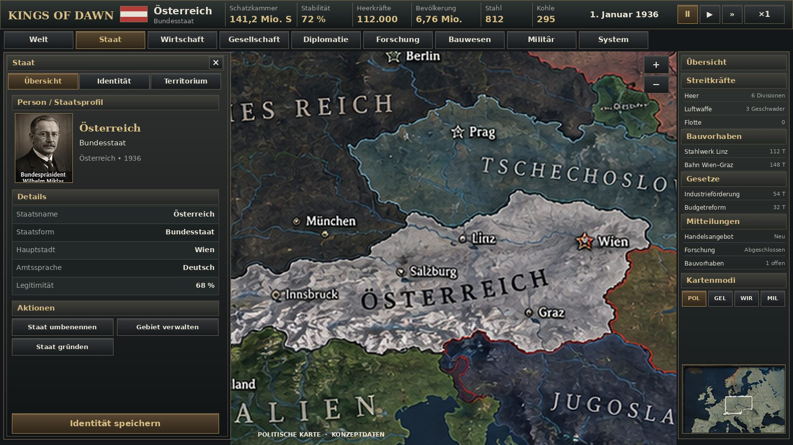

Staat gründen, umbenennen, auflösen, fusionieren, sezessionieren; Haupt- und Regierungssitz, Amtssprachen, Bürgerrecht, Feiertage, Hymne, Kolonien, Protektorate und Vasallen.

**Datenmodell:** Polity, TerritoryClaim, SovereigntyRelation, Citizenship, NationalIdentity

**UI-Mockup-Referenz:** HTML, F-05; Elemente: Staatsname; Staatsform; Hauptstadt; Farbe; Amtssprache; Status; Staat gründen

**Abnahme:** Gründung braucht Gebiet oder expliziten Exilstatus; Fusion bilanziert Vermögen und Schulden; Besitz und Anerkennung sind unabhängig.

**Prompt:**

Setze das Modul 05 – Staaten, Territorien und nationale Identität für KINGS OF DAWN um. Phase: MVP. Verwende den globalen Projektauftrag und die gemeinsame Architektur. Nutze die zugehörige High-Fidelity-Referenz als verbindliche visuelle Basis: feste HUD-Positionen, gleiche Kartenkamera, Messingrahmen und dunkle Stahlpanels, seitlicher Outliner, Minikarte, modulspezifische Controls; implementiere skalierbare UMG/Slate-Komponenten, keine bloße Screenshot-Oberfläche. Nutze verbindlich UE5; implementiere die Fachlogik bevorzugt im Rust-Core, die erforderlichen Engine-Adapter in C++ und die Oberfläche in UMG/Slate. Nutze das KingsOfDawnSimulation-Plugin und die versionierte C-ABI mit Commands und Snapshot-/Delta-Queries. Rein präsentationsbezogene Funktionen bleiben in Unreal; dupliziere keine Simulationslogik. Ergänze Rust-Tests und bei UE-Integration Unreal-Automation-Tests. Die Oberfläche und alle ViewModels müssen die definierte Designrichtung "modernes HOI4" einhalten: dunkle Grand-Strategy-Panels, Kartenfokus, obere Statusleisten, Seiteninspektoren, warme Metall-/Goldakzente, hohe Informationsdichte und zugleich modernisierte Lesbarkeit sowie UX. Fachlicher Umfang: Staat gründen, umbenennen, auflösen, fusionieren, sezessionieren; Haupt- und Regierungssitz, Amtssprachen, Bürgerrecht, Feiertage, Hymne, Kolonien, Protektorate und Vasallen. Datenmodell: Polity, TerritoryClaim, SovereigntyRelation, Citizenship, NationalIdentity. Baue die Oberfläche nach dem zugehörigen Mockup mit folgenden Bedienelementen: Staatsname; Staatsform; Hauptstadt; Farbe; Amtssprache; Status; Staat gründen. Abhängigkeiten: 04. Definiere typisierte Commands, read-only Queries, Domain-Events, Validierung, Transaktionen und Fehler-/Leerzustände. Implementiere die Funktion im Simulationskern und verbinde sie mit der UI; keine rein visuellen Platzhalter. Prüfe Epochenregeln, Realismus-/Sandbox-Berechtigungen und Save-Kompatibilität, soweit relevant. Abnahme: Gründung braucht Gebiet oder expliziten Exilstatus; Fusion bilanziert Vermögen und Schulden; Besitz und Anerkennung sind unabhängig. Liefere Unit- und Integrationstests, UI-Smoke-Test, Seed-Fixture, Dokumentation und eine kurze Liste der verbleibenden Einschränkungen. 

### F-06 – Flaggen, Wappen, Hymnen und Symbolik (MVP)

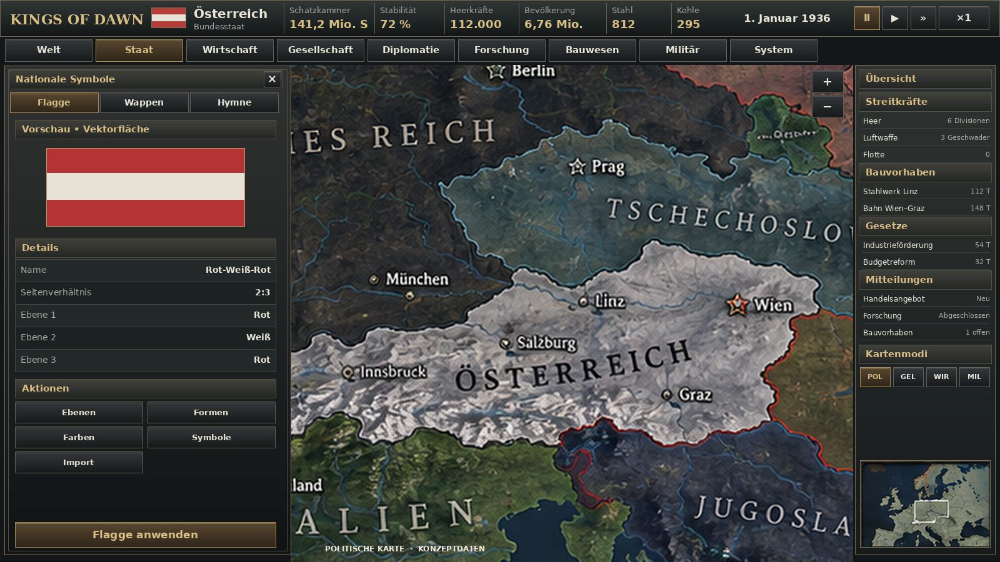

Vektorbasierter Ebeneneditor mit Farben, Geometrie, Text, Symbolen, Wappenschildern; Upload eigener lizenzierter Assets, Vorschau auf Flagge, Siegel und Karte; Hymne als eigene Audiodatei.

**Datenmodell:** SymbolAsset, VectorLayer, HeraldicShield, MediaLicense

**UI-Mockup-Referenz:** HTML, F-06; Elemente: Flagge; Wappen; Ebenen; Schildform; Farben; SVG exportieren

**Abnahme:** Speichern/Laden erhält Ebenen; Export entspricht Vorschau; ungültige SVG-Skripte entfernt; neue Identität aktualisiert alle Ansichten.

**Prompt:**

Setze das Modul 06 – Flaggen, Wappen, Hymnen und Symbolik für KINGS OF DAWN um. Phase: MVP. Verwende den globalen Projektauftrag und die gemeinsame Architektur. Nutze die zugehörige High-Fidelity-Referenz als verbindliche visuelle Basis: feste HUD-Positionen, gleiche Kartenkamera, Messingrahmen und dunkle Stahlpanels, seitlicher Outliner, Minikarte, modulspezifische Controls; implementiere skalierbare UMG/Slate-Komponenten, keine bloße Screenshot-Oberfläche. Nutze verbindlich UE5; implementiere die Fachlogik bevorzugt im Rust-Core, die erforderlichen Engine-Adapter in C++ und die Oberfläche in UMG/Slate. Nutze das KingsOfDawnSimulation-Plugin und die versionierte C-ABI mit Commands und Snapshot-/Delta-Queries. Rein präsentationsbezogene Funktionen bleiben in Unreal; dupliziere keine Simulationslogik. Ergänze Rust-Tests und bei UE-Integration Unreal-Automation-Tests. Die Oberfläche und alle ViewModels müssen die definierte Designrichtung "modernes HOI4" einhalten: dunkle Grand-Strategy-Panels, Kartenfokus, obere Statusleisten, Seiteninspektoren, warme Metall-/Goldakzente, hohe Informationsdichte und zugleich modernisierte Lesbarkeit sowie UX. Fachlicher Umfang: Vektorbasierter Ebeneneditor mit Farben, Geometrie, Text, Symbolen, Wappenschildern; Upload eigener lizenzierter Assets, Vorschau auf Flagge, Siegel und Karte; Hymne als eigene Audiodatei. Datenmodell: SymbolAsset, VectorLayer, HeraldicShield, MediaLicense. Baue die Oberfläche nach dem zugehörigen Mockup mit folgenden Bedienelementen: Flagge; Wappen; Ebenen; Schildform; Farben; SVG exportieren. Abhängigkeiten: 05. Definiere typisierte Commands, read-only Queries, Domain-Events, Validierung, Transaktionen und Fehler-/Leerzustände. Implementiere die Funktion im Simulationskern und verbinde sie mit der UI; keine rein visuellen Platzhalter. Prüfe Epochenregeln, Realismus-/Sandbox-Berechtigungen und Save-Kompatibilität, soweit relevant. Abnahme: Speichern/Laden erhält Ebenen; Export entspricht Vorschau; ungültige SVG-Skripte entfernt; neue Identität aktualisiert alle Ansichten. Liefere Unit- und Integrationstests, UI-Smoke-Test, Seed-Fixture, Dokumentation und eine kurze Liste der verbleibenden Einschränkungen. 

### F-07 – Verfassung und Regierungsform (MVP)

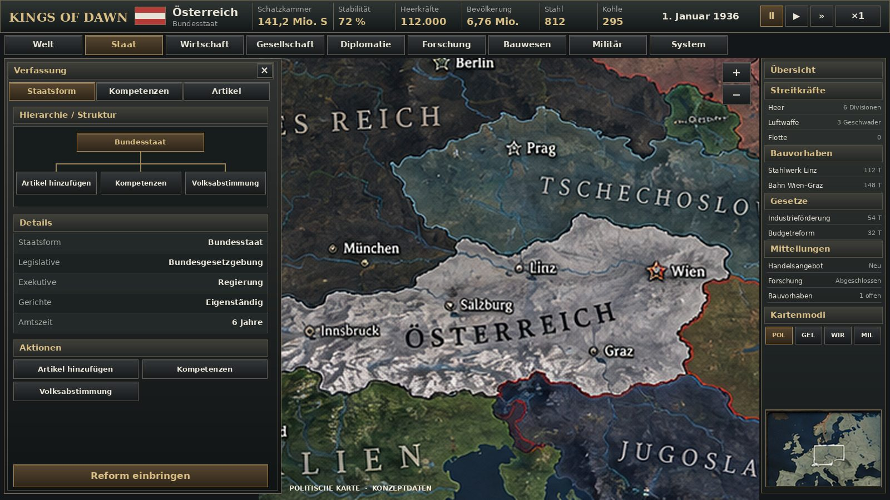

Eigene Regierungsformen mit Staatsoberhaupt, Regierungschef, Amtsdauer, Ernennung, Gewaltenteilung, Notstands- und Änderungsregeln; historische Institutionen per Epoche.

**Datenmodell:** Constitution, Office, Power, AppointmentRule, Amendment

**UI-Mockup-Referenz:** HTML, F-07; Elemente: Monarchie / Republik / frei; Legislative; Exekutive; Gericht; Verfassungsartikel

**Abnahme:** Ein Amt darf nur erlaubte Aktionen ausführen; Reformen folgen geltenden Verfahren; Sandbox-Override ist protokolliert.

**Prompt:**

Setze das Modul 07 – Verfassung und Regierungsform für KINGS OF DAWN um. Phase: MVP. Verwende den globalen Projektauftrag und die gemeinsame Architektur. Nutze die zugehörige High-Fidelity-Referenz als verbindliche visuelle Basis: feste HUD-Positionen, gleiche Kartenkamera, Messingrahmen und dunkle Stahlpanels, seitlicher Outliner, Minikarte, modulspezifische Controls; implementiere skalierbare UMG/Slate-Komponenten, keine bloße Screenshot-Oberfläche. Nutze verbindlich UE5; implementiere die Fachlogik bevorzugt im Rust-Core, die erforderlichen Engine-Adapter in C++ und die Oberfläche in UMG/Slate. Nutze das KingsOfDawnSimulation-Plugin und die versionierte C-ABI mit Commands und Snapshot-/Delta-Queries. Rein präsentationsbezogene Funktionen bleiben in Unreal; dupliziere keine Simulationslogik. Ergänze Rust-Tests und bei UE-Integration Unreal-Automation-Tests. Die Oberfläche und alle ViewModels müssen die definierte Designrichtung "modernes HOI4" einhalten: dunkle Grand-Strategy-Panels, Kartenfokus, obere Statusleisten, Seiteninspektoren, warme Metall-/Goldakzente, hohe Informationsdichte und zugleich modernisierte Lesbarkeit sowie UX. Fachlicher Umfang: Eigene Regierungsformen mit Staatsoberhaupt, Regierungschef, Amtsdauer, Ernennung, Gewaltenteilung, Notstands- und Änderungsregeln; historische Institutionen per Epoche. Datenmodell: Constitution, Office, Power, AppointmentRule, Amendment. Baue die Oberfläche nach dem zugehörigen Mockup mit folgenden Bedienelementen: Monarchie / Republik / frei; Legislative; Exekutive; Gericht; Verfassungsartikel. Abhängigkeiten: 05,08. Definiere typisierte Commands, read-only Queries, Domain-Events, Validierung, Transaktionen und Fehler-/Leerzustände. Implementiere die Funktion im Simulationskern und verbinde sie mit der UI; keine rein visuellen Platzhalter. Prüfe Epochenregeln, Realismus-/Sandbox-Berechtigungen und Save-Kompatibilität, soweit relevant. Abnahme: Ein Amt darf nur erlaubte Aktionen ausführen; Reformen folgen geltenden Verfahren; Sandbox-Override ist protokolliert. Liefere Unit- und Integrationstests, UI-Smoke-Test, Seed-Fixture, Dokumentation und eine kurze Liste der verbleibenden Einschränkungen. 

### F-08 – Personen, Ämter und Charaktereditor (MVP)

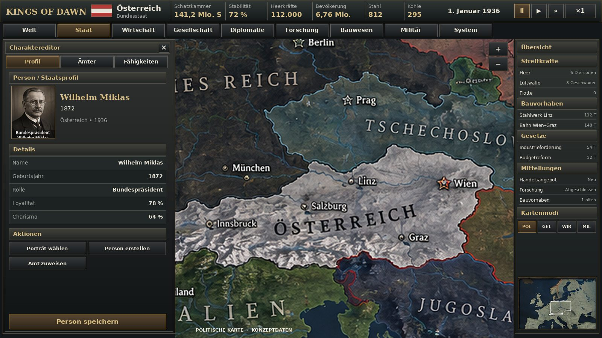

Personen mit Name, Alter, Aussehen, Herkunft, Bildung, Fähigkeiten, Überzeugungen, Beziehungen und Beruf erzeugen; Herrscher, Minister, Richter, Beamte, Generäle, Unternehmer und Forschende ernennen.

**Datenmodell:** Person, Trait, Relationship, Career, OfficeAssignment

**UI-Mockup-Referenz:** HTML, F-08; Elemente: Portrait; Name; Geburtsdatum; Fähigkeiten; Rolle; Loyalität; Ernennen

**Abnahme:** Tote Personen können kein Amt übernehmen; Ernennung respektiert Regeln und Amtsbesetzung; historische Personendaten tragen Quellenstatus.

**Prompt:**

Setze das Modul 08 – Personen, Ämter und Charaktereditor für KINGS OF DAWN um. Phase: MVP. Verwende den globalen Projektauftrag und die gemeinsame Architektur. Nutze die zugehörige High-Fidelity-Referenz als verbindliche visuelle Basis: feste HUD-Positionen, gleiche Kartenkamera, Messingrahmen und dunkle Stahlpanels, seitlicher Outliner, Minikarte, modulspezifische Controls; implementiere skalierbare UMG/Slate-Komponenten, keine bloße Screenshot-Oberfläche. Nutze verbindlich UE5; implementiere die Fachlogik bevorzugt im Rust-Core, die erforderlichen Engine-Adapter in C++ und die Oberfläche in UMG/Slate. Nutze das KingsOfDawnSimulation-Plugin und die versionierte C-ABI mit Commands und Snapshot-/Delta-Queries. Rein präsentationsbezogene Funktionen bleiben in Unreal; dupliziere keine Simulationslogik. Ergänze Rust-Tests und bei UE-Integration Unreal-Automation-Tests. Die Oberfläche und alle ViewModels müssen die definierte Designrichtung "modernes HOI4" einhalten: dunkle Grand-Strategy-Panels, Kartenfokus, obere Statusleisten, Seiteninspektoren, warme Metall-/Goldakzente, hohe Informationsdichte und zugleich modernisierte Lesbarkeit sowie UX. Fachlicher Umfang: Personen mit Name, Alter, Aussehen, Herkunft, Bildung, Fähigkeiten, Überzeugungen, Beziehungen und Beruf erzeugen; Herrscher, Minister, Richter, Beamte, Generäle, Unternehmer und Forschende ernennen. Datenmodell: Person, Trait, Relationship, Career, OfficeAssignment. Baue die Oberfläche nach dem zugehörigen Mockup mit folgenden Bedienelementen: Portrait; Name; Geburtsdatum; Fähigkeiten; Rolle; Loyalität; Ernennen. Abhängigkeiten: 05. Definiere typisierte Commands, read-only Queries, Domain-Events, Validierung, Transaktionen und Fehler-/Leerzustände. Implementiere die Funktion im Simulationskern und verbinde sie mit der UI; keine rein visuellen Platzhalter. Prüfe Epochenregeln, Realismus-/Sandbox-Berechtigungen und Save-Kompatibilität, soweit relevant. Abnahme: Tote Personen können kein Amt übernehmen; Ernennung respektiert Regeln und Amtsbesetzung; historische Personendaten tragen Quellenstatus. Liefere Unit- und Integrationstests, UI-Smoke-Test, Seed-Fixture, Dokumentation und eine kurze Liste der verbleibenden Einschränkungen. 

### F-09 – Dynastien, Erbfolge und Biografien (V1)

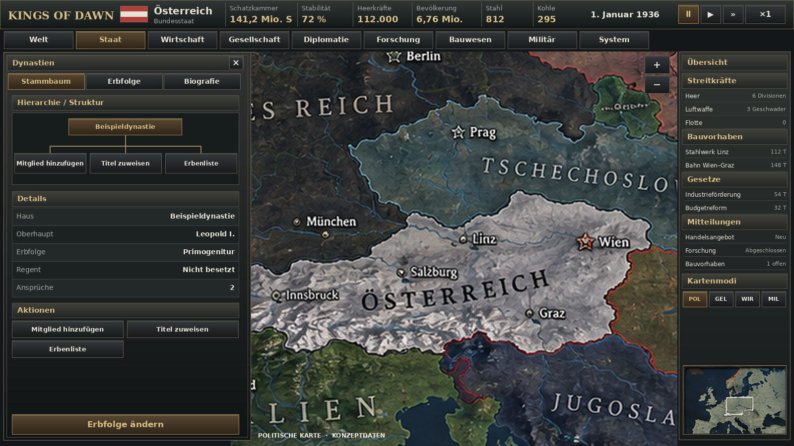

Stammbäume, Ehen, Nachkommen, Adelstitel, Erbfolgegesetz, Regentschaft, Abdankung und Nachfolgekrisen; Personen altern und sterben nachvollziehbar.

**Datenmodell:** Dynasty, Kinship, Title, SuccessionRule, LifeEvent

**UI-Mockup-Referenz:** HTML, F-09; Elemente: Stammbaum; Erbenliste; Titel; Regentschaft; Nachfolge simulieren

**Abnahme:** Keine zyklischen Elternbeziehungen; Erbe nach Testregeln korrekt; Todesfall löst Nachfolge aus und lässt Titelhistorie intakt.

**Prompt:**

Setze das Modul 09 – Dynastien, Erbfolge und Biografien für KINGS OF DAWN um. Phase: V1. Verwende den globalen Projektauftrag und die gemeinsame Architektur. Nutze die zugehörige High-Fidelity-Referenz als verbindliche visuelle Basis: feste HUD-Positionen, gleiche Kartenkamera, Messingrahmen und dunkle Stahlpanels, seitlicher Outliner, Minikarte, modulspezifische Controls; implementiere skalierbare UMG/Slate-Komponenten, keine bloße Screenshot-Oberfläche. Nutze verbindlich UE5; implementiere die Fachlogik bevorzugt im Rust-Core, die erforderlichen Engine-Adapter in C++ und die Oberfläche in UMG/Slate. Nutze das KingsOfDawnSimulation-Plugin und die versionierte C-ABI mit Commands und Snapshot-/Delta-Queries. Rein präsentationsbezogene Funktionen bleiben in Unreal; dupliziere keine Simulationslogik. Ergänze Rust-Tests und bei UE-Integration Unreal-Automation-Tests. Die Oberfläche und alle ViewModels müssen die definierte Designrichtung "modernes HOI4" einhalten: dunkle Grand-Strategy-Panels, Kartenfokus, obere Statusleisten, Seiteninspektoren, warme Metall-/Goldakzente, hohe Informationsdichte und zugleich modernisierte Lesbarkeit sowie UX. Fachlicher Umfang: Stammbäume, Ehen, Nachkommen, Adelstitel, Erbfolgegesetz, Regentschaft, Abdankung und Nachfolgekrisen; Personen altern und sterben nachvollziehbar. Datenmodell: Dynasty, Kinship, Title, SuccessionRule, LifeEvent. Baue die Oberfläche nach dem zugehörigen Mockup mit folgenden Bedienelementen: Stammbaum; Erbenliste; Titel; Regentschaft; Nachfolge simulieren. Abhängigkeiten: 07,08. Definiere typisierte Commands, read-only Queries, Domain-Events, Validierung, Transaktionen und Fehler-/Leerzustände. Implementiere die Funktion im Simulationskern und verbinde sie mit der UI; keine rein visuellen Platzhalter. Prüfe Epochenregeln, Realismus-/Sandbox-Berechtigungen und Save-Kompatibilität, soweit relevant. Abnahme: Keine zyklischen Elternbeziehungen; Erbe nach Testregeln korrekt; Todesfall löst Nachfolge aus und lässt Titelhistorie intakt. Liefere Unit- und Integrationstests, UI-Smoke-Test, Seed-Fixture, Dokumentation und eine kurze Liste der verbleibenden Einschränkungen. 

### F-10 – Gesetzgebung und Gesetzeseditor (MVP)

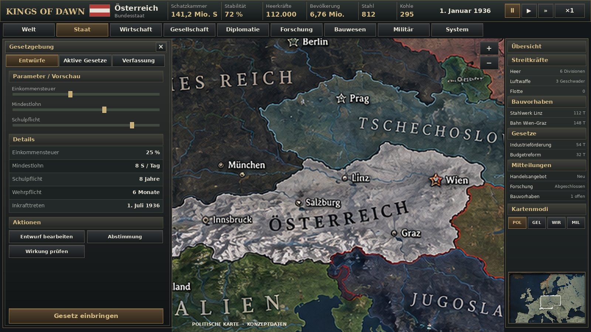

Gesetze als strukturierte Regeln mit Typ, Parametern, Adressaten, Geltungsbereich, Datum, Durchsetzung und Sanktionen; Entwürfe, Abstimmung, Inkrafttreten, Aufhebung, Normenkonflikt.

**Datenmodell:** Law, Clause, RuleExpression, LegislativeVote, Enforcement

**UI-Mockup-Referenz:** HTML, F-10; Elemente: Einkommensteuer; Mindestlohn; Schulpflicht; Wehrpflicht; Gültig ab; Folgenvorschau

**Abnahme:** Ungültige Parameter werden abgelehnt; Änderung wirkt erst zum Datum; Testgesetz ändert Haushalts-/Arbeitsmarktmodell, keine bloßen UI-Werte.

**Prompt:**

Setze das Modul 10 – Gesetzgebung und Gesetzeseditor für KINGS OF DAWN um. Phase: MVP. Verwende den globalen Projektauftrag und die gemeinsame Architektur. Nutze die zugehörige High-Fidelity-Referenz als verbindliche visuelle Basis: feste HUD-Positionen, gleiche Kartenkamera, Messingrahmen und dunkle Stahlpanels, seitlicher Outliner, Minikarte, modulspezifische Controls; implementiere skalierbare UMG/Slate-Komponenten, keine bloße Screenshot-Oberfläche. Nutze verbindlich UE5; implementiere die Fachlogik bevorzugt im Rust-Core, die erforderlichen Engine-Adapter in C++ und die Oberfläche in UMG/Slate. Nutze das KingsOfDawnSimulation-Plugin und die versionierte C-ABI mit Commands und Snapshot-/Delta-Queries. Rein präsentationsbezogene Funktionen bleiben in Unreal; dupliziere keine Simulationslogik. Ergänze Rust-Tests und bei UE-Integration Unreal-Automation-Tests. Die Oberfläche und alle ViewModels müssen die definierte Designrichtung "modernes HOI4" einhalten: dunkle Grand-Strategy-Panels, Kartenfokus, obere Statusleisten, Seiteninspektoren, warme Metall-/Goldakzente, hohe Informationsdichte und zugleich modernisierte Lesbarkeit sowie UX. Fachlicher Umfang: Gesetze als strukturierte Regeln mit Typ, Parametern, Adressaten, Geltungsbereich, Datum, Durchsetzung und Sanktionen; Entwürfe, Abstimmung, Inkrafttreten, Aufhebung, Normenkonflikt. Datenmodell: Law, Clause, RuleExpression, LegislativeVote, Enforcement. Baue die Oberfläche nach dem zugehörigen Mockup mit folgenden Bedienelementen: Einkommensteuer; Mindestlohn; Schulpflicht; Wehrpflicht; Gültig ab; Folgenvorschau. Abhängigkeiten: 07,12. Definiere typisierte Commands, read-only Queries, Domain-Events, Validierung, Transaktionen und Fehler-/Leerzustände. Implementiere die Funktion im Simulationskern und verbinde sie mit der UI; keine rein visuellen Platzhalter. Prüfe Epochenregeln, Realismus-/Sandbox-Berechtigungen und Save-Kompatibilität, soweit relevant. Abnahme: Ungültige Parameter werden abgelehnt; Änderung wirkt erst zum Datum; Testgesetz ändert Haushalts-/Arbeitsmarktmodell, keine bloßen UI-Werte. Liefere Unit- und Integrationstests, UI-Smoke-Test, Seed-Fixture, Dokumentation und eine kurze Liste der verbleibenden Einschränkungen. Baue eine allowlist-basierte typisierte DSL ohne eval; simuliere die Auswirkung eines Entwurfs in einem isolierten Snapshot.

### F-11 – Parteien, Ideologien und Wahlen (V1)

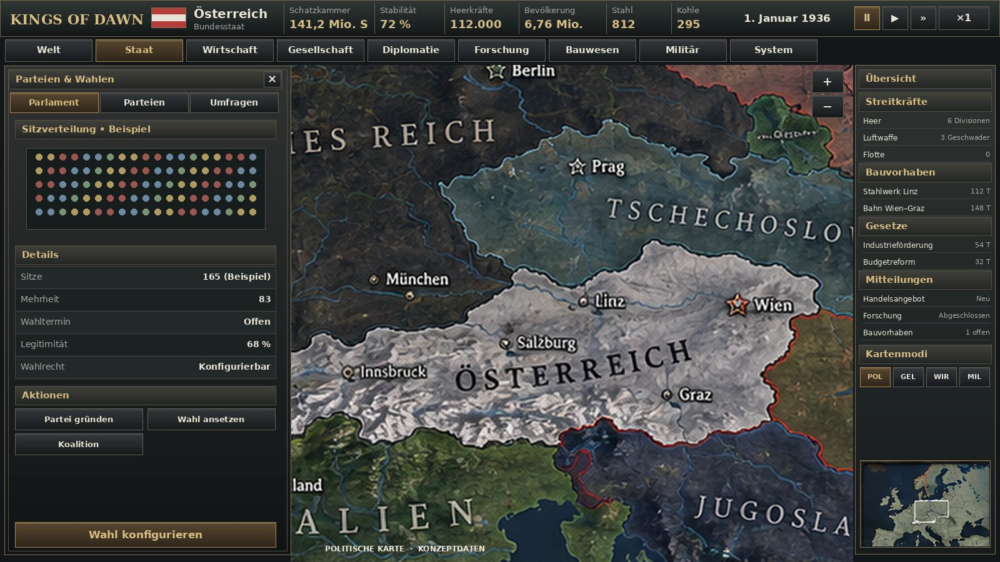

Eigene Ideologien mit politischem Werteprofil; Parteien, Wahlkreise, Wahlrecht, Koalitionen, Wahlprogramme, Kampagnen und Meinungsumfragen; Opposition und parlamentarische Mehrheiten.

**Datenmodell:** Ideology, Party, VoterGroup, Election, SeatAllocation, Coalition

**UI-Mockup-Referenz:** HTML, F-11; Elemente: Parlament; Sitzverteilung; Wahltermin; Umfrage; Koalition bilden

**Abnahme:** Sitze entsprechen gewähltem Verfahren; Stimmen sind bilanziert; Wahlberechtigung folgt Gesetz; Koalition erfordert Zustimmung.

**Prompt:**

Setze das Modul 11 – Parteien, Ideologien und Wahlen für KINGS OF DAWN um. Phase: V1. Verwende den globalen Projektauftrag und die gemeinsame Architektur. Nutze die zugehörige High-Fidelity-Referenz als verbindliche visuelle Basis: feste HUD-Positionen, gleiche Kartenkamera, Messingrahmen und dunkle Stahlpanels, seitlicher Outliner, Minikarte, modulspezifische Controls; implementiere skalierbare UMG/Slate-Komponenten, keine bloße Screenshot-Oberfläche. Nutze verbindlich UE5; implementiere die Fachlogik bevorzugt im Rust-Core, die erforderlichen Engine-Adapter in C++ und die Oberfläche in UMG/Slate. Nutze das KingsOfDawnSimulation-Plugin und die versionierte C-ABI mit Commands und Snapshot-/Delta-Queries. Rein präsentationsbezogene Funktionen bleiben in Unreal; dupliziere keine Simulationslogik. Ergänze Rust-Tests und bei UE-Integration Unreal-Automation-Tests. Die Oberfläche und alle ViewModels müssen die definierte Designrichtung "modernes HOI4" einhalten: dunkle Grand-Strategy-Panels, Kartenfokus, obere Statusleisten, Seiteninspektoren, warme Metall-/Goldakzente, hohe Informationsdichte und zugleich modernisierte Lesbarkeit sowie UX. Fachlicher Umfang: Eigene Ideologien mit politischem Werteprofil; Parteien, Wahlkreise, Wahlrecht, Koalitionen, Wahlprogramme, Kampagnen und Meinungsumfragen; Opposition und parlamentarische Mehrheiten. Datenmodell: Ideology, Party, VoterGroup, Election, SeatAllocation, Coalition. Baue die Oberfläche nach dem zugehörigen Mockup mit folgenden Bedienelementen: Parlament; Sitzverteilung; Wahltermin; Umfrage; Koalition bilden. Abhängigkeiten: 07,08,10,19. Definiere typisierte Commands, read-only Queries, Domain-Events, Validierung, Transaktionen und Fehler-/Leerzustände. Implementiere die Funktion im Simulationskern und verbinde sie mit der UI; keine rein visuellen Platzhalter. Prüfe Epochenregeln, Realismus-/Sandbox-Berechtigungen und Save-Kompatibilität, soweit relevant. Abnahme: Sitze entsprechen gewähltem Verfahren; Stimmen sind bilanziert; Wahlberechtigung folgt Gesetz; Koalition erfordert Zustimmung. Liefere Unit- und Integrationstests, UI-Smoke-Test, Seed-Fixture, Dokumentation und eine kurze Liste der verbleibenden Einschränkungen. 

### F-12 – Verwaltung, Ministerien und öffentliche Dienste (MVP)

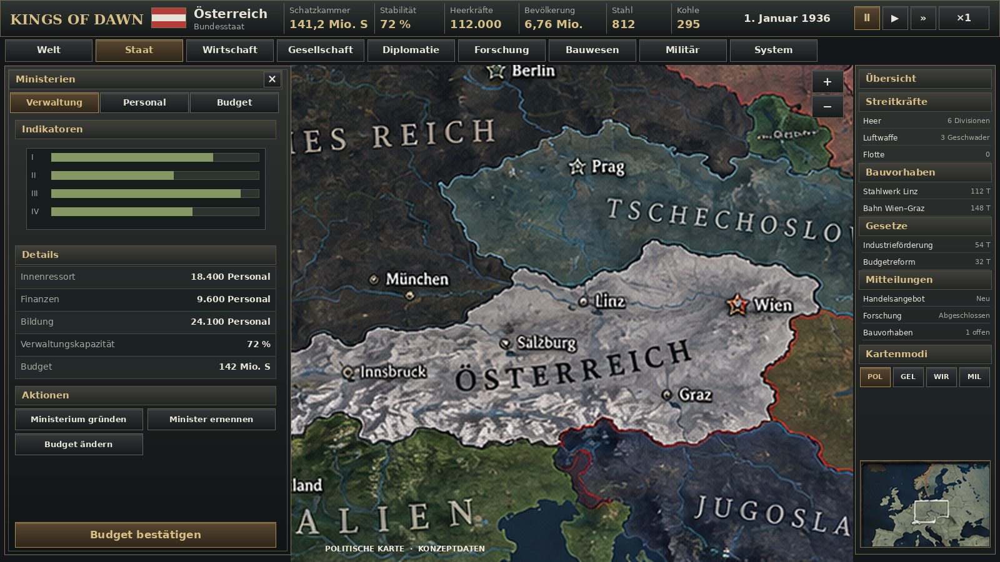

Ministerien, Behörden, Zuständigkeiten, Personal und Budgets; Verwaltungskapazität, Korruption, Effizienz und Steuerdurchsetzung; Föderalismus und Lokalautonomie.

**Datenmodell:** Agency, Ministry, CivilService, BudgetAllocation, AdministrativeCapacity

**UI-Mockup-Referenz:** HTML, F-12; Elemente: Ministerium; Personal; Budget; Leistung; Korruptionsrisiko

**Abnahme:** Budget wird tatsächlich verbucht; fehlendes Personal senkt Leistungsfähigkeit; Amtswechsel ändert Verantwortlichkeit, nicht magisch das Vermögen.

**Prompt:**

Setze das Modul 12 – Verwaltung, Ministerien und öffentliche Dienste für KINGS OF DAWN um. Phase: MVP. Verwende den globalen Projektauftrag und die gemeinsame Architektur. Nutze die zugehörige High-Fidelity-Referenz als verbindliche visuelle Basis: feste HUD-Positionen, gleiche Kartenkamera, Messingrahmen und dunkle Stahlpanels, seitlicher Outliner, Minikarte, modulspezifische Controls; implementiere skalierbare UMG/Slate-Komponenten, keine bloße Screenshot-Oberfläche. Nutze verbindlich UE5; implementiere die Fachlogik bevorzugt im Rust-Core, die erforderlichen Engine-Adapter in C++ und die Oberfläche in UMG/Slate. Nutze das KingsOfDawnSimulation-Plugin und die versionierte C-ABI mit Commands und Snapshot-/Delta-Queries. Rein präsentationsbezogene Funktionen bleiben in Unreal; dupliziere keine Simulationslogik. Ergänze Rust-Tests und bei UE-Integration Unreal-Automation-Tests. Die Oberfläche und alle ViewModels müssen die definierte Designrichtung "modernes HOI4" einhalten: dunkle Grand-Strategy-Panels, Kartenfokus, obere Statusleisten, Seiteninspektoren, warme Metall-/Goldakzente, hohe Informationsdichte und zugleich modernisierte Lesbarkeit sowie UX. Fachlicher Umfang: Ministerien, Behörden, Zuständigkeiten, Personal und Budgets; Verwaltungskapazität, Korruption, Effizienz und Steuerdurchsetzung; Föderalismus und Lokalautonomie. Datenmodell: Agency, Ministry, CivilService, BudgetAllocation, AdministrativeCapacity. Baue die Oberfläche nach dem zugehörigen Mockup mit folgenden Bedienelementen: Ministerium; Personal; Budget; Leistung; Korruptionsrisiko. Abhängigkeiten: 07,08,15. Definiere typisierte Commands, read-only Queries, Domain-Events, Validierung, Transaktionen und Fehler-/Leerzustände. Implementiere die Funktion im Simulationskern und verbinde sie mit der UI; keine rein visuellen Platzhalter. Prüfe Epochenregeln, Realismus-/Sandbox-Berechtigungen und Save-Kompatibilität, soweit relevant. Abnahme: Budget wird tatsächlich verbucht; fehlendes Personal senkt Leistungsfähigkeit; Amtswechsel ändert Verantwortlichkeit, nicht magisch das Vermögen. Liefere Unit- und Integrationstests, UI-Smoke-Test, Seed-Fixture, Dokumentation und eine kurze Liste der verbleibenden Einschränkungen. 

### F-13 – Justiz, Sicherheit und Bürgerrechte (V1)

Gerichte, Rechtsmittel, Polizeikapazität, Straf- und Zivilrecht, Grundrechte, Konflikte zwischen Normen; Kriminalität als aggregierte Simulation mit rechtlichen und sozialen Faktoren.

**Datenmodell:** Court, Case, Right, PoliceAgency, LegalDecision

**UI-Mockup-Referenz:** HTML, F-13; Elemente: Gerichte; Fallbestand; Rechtsmittel; Grundrechtsstatus; Polizei

**Abnahme:** Verfassungswidrige Regel kann angefochten werden; Fallbearbeitung benötigt Kapazität; keine pauschale Kriminalitätszuschreibung nach Kultur oder Religion.

**Prompt:**

Setze das Modul 13 – Justiz, Sicherheit und Bürgerrechte für KINGS OF DAWN um. Phase: V1. Verwende den globalen Projektauftrag und die gemeinsame Architektur. Nutze die zugehörige High-Fidelity-Referenz als verbindliche visuelle Basis: feste HUD-Positionen, gleiche Kartenkamera, Messingrahmen und dunkle Stahlpanels, seitlicher Outliner, Minikarte, modulspezifische Controls; implementiere skalierbare UMG/Slate-Komponenten, keine bloße Screenshot-Oberfläche. Nutze verbindlich UE5; implementiere die Fachlogik bevorzugt im Rust-Core, die erforderlichen Engine-Adapter in C++ und die Oberfläche in UMG/Slate. Nutze das KingsOfDawnSimulation-Plugin und die versionierte C-ABI mit Commands und Snapshot-/Delta-Queries. Rein präsentationsbezogene Funktionen bleiben in Unreal; dupliziere keine Simulationslogik. Ergänze Rust-Tests und bei UE-Integration Unreal-Automation-Tests. Die Oberfläche und alle ViewModels müssen die definierte Designrichtung "modernes HOI4" einhalten: dunkle Grand-Strategy-Panels, Kartenfokus, obere Statusleisten, Seiteninspektoren, warme Metall-/Goldakzente, hohe Informationsdichte und zugleich modernisierte Lesbarkeit sowie UX. Fachlicher Umfang: Gerichte, Rechtsmittel, Polizeikapazität, Straf- und Zivilrecht, Grundrechte, Konflikte zwischen Normen; Kriminalität als aggregierte Simulation mit rechtlichen und sozialen Faktoren. Datenmodell: Court, Case, Right, PoliceAgency, LegalDecision. Baue die Oberfläche nach dem zugehörigen Mockup mit folgenden Bedienelementen: Gerichte; Fallbestand; Rechtsmittel; Grundrechtsstatus; Polizei. Abhängigkeiten: 07,10,12. Definiere typisierte Commands, read-only Queries, Domain-Events, Validierung, Transaktionen und Fehler-/Leerzustände. Implementiere die Funktion im Simulationskern und verbinde sie mit der UI; keine rein visuellen Platzhalter. Prüfe Epochenregeln, Realismus-/Sandbox-Berechtigungen und Save-Kompatibilität, soweit relevant. Abnahme: Verfassungswidrige Regel kann angefochten werden; Fallbearbeitung benötigt Kapazität; keine pauschale Kriminalitätszuschreibung nach Kultur oder Religion. Liefere Unit- und Integrationstests, UI-Smoke-Test, Seed-Fixture, Dokumentation und eine kurze Liste der verbleibenden Einschränkungen. 

### F-14 – Währungen und Zentralbank (MVP)

Währung, ISO-artiger interner Code, Stückelung, Münzen/Banknoten, Metallgeld, Warengeld, Fiatgeld; Geldangebot, Reserven, Zinsen, feste/flexible Kurse, Währungsunion, Umtausch und Zahlungsbilanz.

**Datenmodell:** Currency, MonetaryRegime, CentralBank, FxQuote, ReserveAsset, NoteDesign

**UI-Mockup-Referenz:** HTML, F-14; Elemente: IKR; Kurs 1,24 Referenzeinheiten; Geldmenge; Reserven; Leitzins; Regime

**Abnahme:** Kurse endogen und nicht vom Spieler beliebig festsetzbar im Realismusmodus; feste Kurse brauchen Reserven; Buchungen ausgeglichen; historische Regime verfügbar.

**Prompt:**

Setze das Modul 14 – Währungen und Zentralbank für KINGS OF DAWN um. Phase: MVP. Verwende den globalen Projektauftrag und die gemeinsame Architektur. Nutze die zugehörige High-Fidelity-Referenz als verbindliche visuelle Basis: feste HUD-Positionen, gleiche Kartenkamera, Messingrahmen und dunkle Stahlpanels, seitlicher Outliner, Minikarte, modulspezifische Controls; implementiere skalierbare UMG/Slate-Komponenten, keine bloße Screenshot-Oberfläche. Nutze verbindlich UE5; implementiere die Fachlogik bevorzugt im Rust-Core, die erforderlichen Engine-Adapter in C++ und die Oberfläche in UMG/Slate. Nutze das KingsOfDawnSimulation-Plugin und die versionierte C-ABI mit Commands und Snapshot-/Delta-Queries. Rein präsentationsbezogene Funktionen bleiben in Unreal; dupliziere keine Simulationslogik. Ergänze Rust-Tests und bei UE-Integration Unreal-Automation-Tests. Die Oberfläche und alle ViewModels müssen die definierte Designrichtung "modernes HOI4" einhalten: dunkle Grand-Strategy-Panels, Kartenfokus, obere Statusleisten, Seiteninspektoren, warme Metall-/Goldakzente, hohe Informationsdichte und zugleich modernisierte Lesbarkeit sowie UX. Fachlicher Umfang: Währung, ISO-artiger interner Code, Stückelung, Münzen/Banknoten, Metallgeld, Warengeld, Fiatgeld; Geldangebot, Reserven, Zinsen, feste/flexible Kurse, Währungsunion, Umtausch und Zahlungsbilanz. Datenmodell: Currency, MonetaryRegime, CentralBank, FxQuote, ReserveAsset, NoteDesign. Baue die Oberfläche nach dem zugehörigen Mockup mit folgenden Bedienelementen: IKR; Kurs 1,24 Referenzeinheiten; Geldmenge; Reserven; Leitzins; Regime. Abhängigkeiten: 05,15,16. Definiere typisierte Commands, read-only Queries, Domain-Events, Validierung, Transaktionen und Fehler-/Leerzustände. Implementiere die Funktion im Simulationskern und verbinde sie mit der UI; keine rein visuellen Platzhalter. Prüfe Epochenregeln, Realismus-/Sandbox-Berechtigungen und Save-Kompatibilität, soweit relevant. Abnahme: Kurse endogen und nicht vom Spieler beliebig festsetzbar im Realismusmodus; feste Kurse brauchen Reserven; Buchungen ausgeglichen; historische Regime verfügbar. Liefere Unit- und Integrationstests, UI-Smoke-Test, Seed-Fixture, Dokumentation und eine kurze Liste der verbleibenden Einschränkungen. Definiere Regimeadapter für Metallgeld, Fiat, Peg und Tauschökonomie; FX-Clearing und Bilanztests für Reservenerschöpfung, Konvertierung und Währungsreform.

### F-15 – Staatshaushalt, Steuern und Staatsverschuldung (MVP)

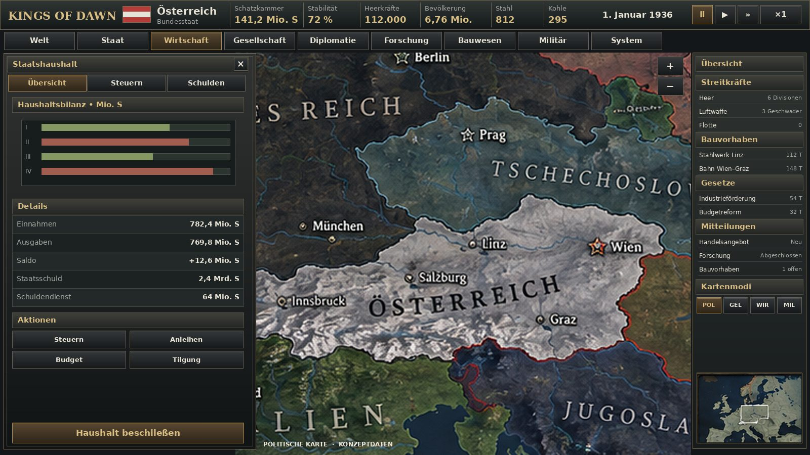

Doppelte Buchführung, Steuerarten und Progression, Ausgaben, Transfers, Anleihen, Schulden, Laufzeiten, Zinsen, Umschuldung, Zahlungsausfall und Haushaltsplanung.

**Datenmodell:** LedgerAccount, JournalEntry, TaxRule, Budget, Bond, DebtSchedule

**UI-Mockup-Referenz:** HTML, F-15; Elemente: Einnahmen; Ausgaben; Saldo; Schuldendienst; Anleihe; Budget freigeben

**Abnahme:** Soll = Haben je Buchung; keine unfinanzierten Ausgaben; Zinszahlungen bei Fälligkeit; Defizit ist mit Finanzierung oder Rückständen verknüpft.

**Prompt:**

Setze das Modul 15 – Staatshaushalt, Steuern und Staatsverschuldung für KINGS OF DAWN um. Phase: MVP. Verwende den globalen Projektauftrag und die gemeinsame Architektur. Nutze die zugehörige High-Fidelity-Referenz als verbindliche visuelle Basis: feste HUD-Positionen, gleiche Kartenkamera, Messingrahmen und dunkle Stahlpanels, seitlicher Outliner, Minikarte, modulspezifische Controls; implementiere skalierbare UMG/Slate-Komponenten, keine bloße Screenshot-Oberfläche. Nutze verbindlich UE5; implementiere die Fachlogik bevorzugt im Rust-Core, die erforderlichen Engine-Adapter in C++ und die Oberfläche in UMG/Slate. Nutze das KingsOfDawnSimulation-Plugin und die versionierte C-ABI mit Commands und Snapshot-/Delta-Queries. Rein präsentationsbezogene Funktionen bleiben in Unreal; dupliziere keine Simulationslogik. Ergänze Rust-Tests und bei UE-Integration Unreal-Automation-Tests. Die Oberfläche und alle ViewModels müssen die definierte Designrichtung "modernes HOI4" einhalten: dunkle Grand-Strategy-Panels, Kartenfokus, obere Statusleisten, Seiteninspektoren, warme Metall-/Goldakzente, hohe Informationsdichte und zugleich modernisierte Lesbarkeit sowie UX. Fachlicher Umfang: Doppelte Buchführung, Steuerarten und Progression, Ausgaben, Transfers, Anleihen, Schulden, Laufzeiten, Zinsen, Umschuldung, Zahlungsausfall und Haushaltsplanung. Datenmodell: LedgerAccount, JournalEntry, TaxRule, Budget, Bond, DebtSchedule. Baue die Oberfläche nach dem zugehörigen Mockup mit folgenden Bedienelementen: Einnahmen; Ausgaben; Saldo; Schuldendienst; Anleihe; Budget freigeben. Abhängigkeiten: 10,12. Definiere typisierte Commands, read-only Queries, Domain-Events, Validierung, Transaktionen und Fehler-/Leerzustände. Implementiere die Funktion im Simulationskern und verbinde sie mit der UI; keine rein visuellen Platzhalter. Prüfe Epochenregeln, Realismus-/Sandbox-Berechtigungen und Save-Kompatibilität, soweit relevant. Abnahme: Soll = Haben je Buchung; keine unfinanzierten Ausgaben; Zinszahlungen bei Fälligkeit; Defizit ist mit Finanzierung oder Rückständen verknüpft. Liefere Unit- und Integrationstests, UI-Smoke-Test, Seed-Fixture, Dokumentation und eine kurze Liste der verbleibenden Einschränkungen. Implementiere journalbasierte doppelte Buchführung mit unveränderlichen Einträgen und Storno statt Löschen; prüfe jede Währung getrennt.

### F-16 – Waren, Märkte und Preissimulation (MVP)

Rohstoffe, Lebensmittel, Zwischenprodukte und Güter; regionale Bestände, Verbrauch, Nachfrage, Substitution, Preise, Knappheit, Inflation und Marktzugang; Tauschhandel bei fehlender Geldwirtschaft.

**Datenmodell:** Commodity, Inventory, Market, DemandOrder, SupplyOrder, PriceIndex

**UI-Mockup-Referenz:** HTML, F-16; Elemente: Getreide; Preis; Angebot/Nachfrage; Lager; regionale Märkte

**Abnahme:** Bestände niemals negativ; Preise reagieren begrenzt auf Knappheit; Produktion und Konsum bilanziert; Inflation aus Warenkorb.

**Prompt:**

Setze das Modul 16 – Waren, Märkte und Preissimulation für KINGS OF DAWN um. Phase: MVP. Verwende den globalen Projektauftrag und die gemeinsame Architektur. Nutze die zugehörige High-Fidelity-Referenz als verbindliche visuelle Basis: feste HUD-Positionen, gleiche Kartenkamera, Messingrahmen und dunkle Stahlpanels, seitlicher Outliner, Minikarte, modulspezifische Controls; implementiere skalierbare UMG/Slate-Komponenten, keine bloße Screenshot-Oberfläche. Nutze verbindlich UE5; implementiere die Fachlogik bevorzugt im Rust-Core, die erforderlichen Engine-Adapter in C++ und die Oberfläche in UMG/Slate. Nutze das KingsOfDawnSimulation-Plugin und die versionierte C-ABI mit Commands und Snapshot-/Delta-Queries. Rein präsentationsbezogene Funktionen bleiben in Unreal; dupliziere keine Simulationslogik. Ergänze Rust-Tests und bei UE-Integration Unreal-Automation-Tests. Die Oberfläche und alle ViewModels müssen die definierte Designrichtung "modernes HOI4" einhalten: dunkle Grand-Strategy-Panels, Kartenfokus, obere Statusleisten, Seiteninspektoren, warme Metall-/Goldakzente, hohe Informationsdichte und zugleich modernisierte Lesbarkeit sowie UX. Fachlicher Umfang: Rohstoffe, Lebensmittel, Zwischenprodukte und Güter; regionale Bestände, Verbrauch, Nachfrage, Substitution, Preise, Knappheit, Inflation und Marktzugang; Tauschhandel bei fehlender Geldwirtschaft. Datenmodell: Commodity, Inventory, Market, DemandOrder, SupplyOrder, PriceIndex. Baue die Oberfläche nach dem zugehörigen Mockup mit folgenden Bedienelementen: Getreide; Preis; Angebot/Nachfrage; Lager; regionale Märkte. Abhängigkeiten: 04,19,21. Definiere typisierte Commands, read-only Queries, Domain-Events, Validierung, Transaktionen und Fehler-/Leerzustände. Implementiere die Funktion im Simulationskern und verbinde sie mit der UI; keine rein visuellen Platzhalter. Prüfe Epochenregeln, Realismus-/Sandbox-Berechtigungen und Save-Kompatibilität, soweit relevant. Abnahme: Bestände niemals negativ; Preise reagieren begrenzt auf Knappheit; Produktion und Konsum bilanziert; Inflation aus Warenkorb. Liefere Unit- und Integrationstests, UI-Smoke-Test, Seed-Fixture, Dokumentation und eine kurze Liste der verbleibenden Einschränkungen. Definiere gedämpfte Preisfindung, Warenkorb und Lagerbilanz; teste Angebotsschock und Erholung.

### F-17 – Unternehmen, Produktion und Lieferketten (MVP)

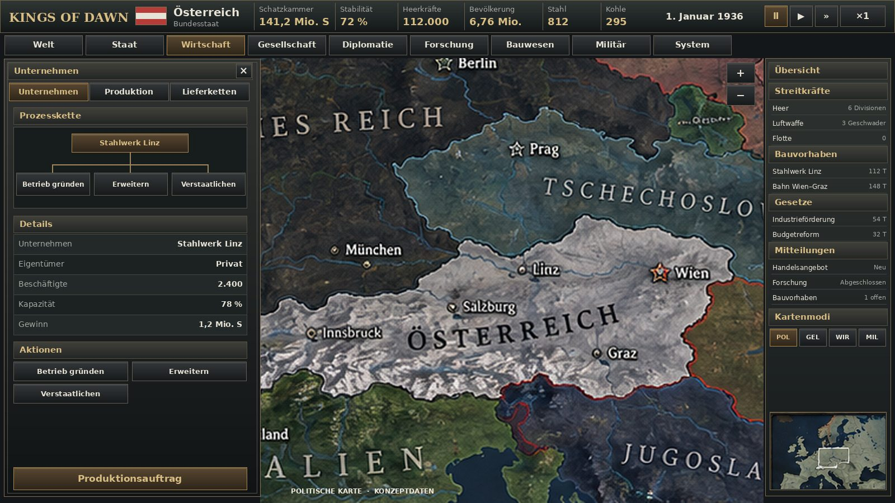

Unternehmen gründen, Eigentümer, private/staatliche Betriebe, Genossenschaften, Produktionsrezepte, Maschinen, Arbeitskräfte, Investitionen, Gewinne, Insolvenz und Privatisierung.

**Datenmodell:** Firm, Ownership, Recipe, Facility, Workforce, BalanceSheet

**UI-Mockup-Referenz:** HTML, F-17; Elemente: Unternehmen; Eigentümer; Input; Output; Gewinn; Fabrik bauen

**Abnahme:** Produktion ist durch Inputs, Arbeit und Kapazität begrenzt; Insolvenz löscht keine Schulden ohne Buchung; Eigentümerwechsel nachvollziehbar.

**Prompt:**

Setze das Modul 17 – Unternehmen, Produktion und Lieferketten für KINGS OF DAWN um. Phase: MVP. Verwende den globalen Projektauftrag und die gemeinsame Architektur. Nutze die zugehörige High-Fidelity-Referenz als verbindliche visuelle Basis: feste HUD-Positionen, gleiche Kartenkamera, Messingrahmen und dunkle Stahlpanels, seitlicher Outliner, Minikarte, modulspezifische Controls; implementiere skalierbare UMG/Slate-Komponenten, keine bloße Screenshot-Oberfläche. Nutze verbindlich UE5; implementiere die Fachlogik bevorzugt im Rust-Core, die erforderlichen Engine-Adapter in C++ und die Oberfläche in UMG/Slate. Nutze das KingsOfDawnSimulation-Plugin und die versionierte C-ABI mit Commands und Snapshot-/Delta-Queries. Rein präsentationsbezogene Funktionen bleiben in Unreal; dupliziere keine Simulationslogik. Ergänze Rust-Tests und bei UE-Integration Unreal-Automation-Tests. Die Oberfläche und alle ViewModels müssen die definierte Designrichtung "modernes HOI4" einhalten: dunkle Grand-Strategy-Panels, Kartenfokus, obere Statusleisten, Seiteninspektoren, warme Metall-/Goldakzente, hohe Informationsdichte und zugleich modernisierte Lesbarkeit sowie UX. Fachlicher Umfang: Unternehmen gründen, Eigentümer, private/staatliche Betriebe, Genossenschaften, Produktionsrezepte, Maschinen, Arbeitskräfte, Investitionen, Gewinne, Insolvenz und Privatisierung. Datenmodell: Firm, Ownership, Recipe, Facility, Workforce, BalanceSheet. Baue die Oberfläche nach dem zugehörigen Mockup mit folgenden Bedienelementen: Unternehmen; Eigentümer; Input; Output; Gewinn; Fabrik bauen. Abhängigkeiten: 15,16,19,21. Definiere typisierte Commands, read-only Queries, Domain-Events, Validierung, Transaktionen und Fehler-/Leerzustände. Implementiere die Funktion im Simulationskern und verbinde sie mit der UI; keine rein visuellen Platzhalter. Prüfe Epochenregeln, Realismus-/Sandbox-Berechtigungen und Save-Kompatibilität, soweit relevant. Abnahme: Produktion ist durch Inputs, Arbeit und Kapazität begrenzt; Insolvenz löscht keine Schulden ohne Buchung; Eigentümerwechsel nachvollziehbar. Liefere Unit- und Integrationstests, UI-Smoke-Test, Seed-Fixture, Dokumentation und eine kurze Liste der verbleibenden Einschränkungen. 

### F-18 – Handel, Banken und Kapitalmarkt (V1)

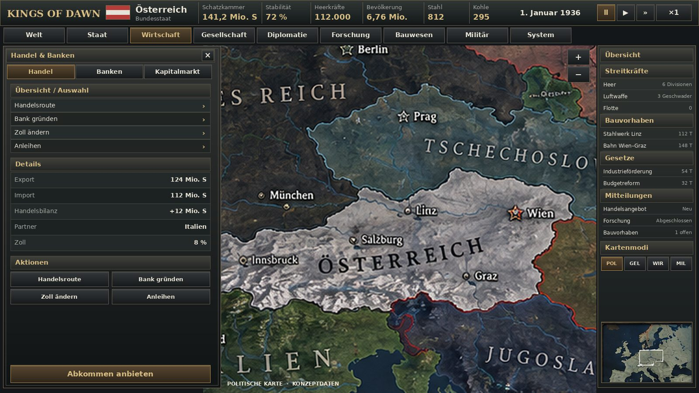

Import/Export, Zölle, Embargos, Handelswege, Handelsabkommen, Devisenbedarf, Kreditvergabe, Einlagen, Aktien und Finanzkrisen; historische Marktformen statt moderner Börsen in der Antike.

**Datenmodell:** TradeRoute, Tariff, Shipment, Bank, Loan, Security, Exchange

**UI-Mockup-Referenz:** HTML, F-18; Elemente: Handelsbilanz; Partner; Zoll; Frachtkosten; Kredit; Wertpapiere

**Abnahme:** Transportkapazität limitiert Handel; Sanktionen beeinflussen Aufträge; Kredite erzeugen passende Buchungen; Kursrisiken bleiben sichtbar.

**Prompt:**

Setze das Modul 18 – Handel, Banken und Kapitalmarkt für KINGS OF DAWN um. Phase: V1. Verwende den globalen Projektauftrag und die gemeinsame Architektur. Nutze die zugehörige High-Fidelity-Referenz als verbindliche visuelle Basis: feste HUD-Positionen, gleiche Kartenkamera, Messingrahmen und dunkle Stahlpanels, seitlicher Outliner, Minikarte, modulspezifische Controls; implementiere skalierbare UMG/Slate-Komponenten, keine bloße Screenshot-Oberfläche. Nutze verbindlich UE5; implementiere die Fachlogik bevorzugt im Rust-Core, die erforderlichen Engine-Adapter in C++ und die Oberfläche in UMG/Slate. Nutze das KingsOfDawnSimulation-Plugin und die versionierte C-ABI mit Commands und Snapshot-/Delta-Queries. Rein präsentationsbezogene Funktionen bleiben in Unreal; dupliziere keine Simulationslogik. Ergänze Rust-Tests und bei UE-Integration Unreal-Automation-Tests. Die Oberfläche und alle ViewModels müssen die definierte Designrichtung "modernes HOI4" einhalten: dunkle Grand-Strategy-Panels, Kartenfokus, obere Statusleisten, Seiteninspektoren, warme Metall-/Goldakzente, hohe Informationsdichte und zugleich modernisierte Lesbarkeit sowie UX. Fachlicher Umfang: Import/Export, Zölle, Embargos, Handelswege, Handelsabkommen, Devisenbedarf, Kreditvergabe, Einlagen, Aktien und Finanzkrisen; historische Marktformen statt moderner Börsen in der Antike. Datenmodell: TradeRoute, Tariff, Shipment, Bank, Loan, Security, Exchange. Baue die Oberfläche nach dem zugehörigen Mockup mit folgenden Bedienelementen: Handelsbilanz; Partner; Zoll; Frachtkosten; Kredit; Wertpapiere. Abhängigkeiten: 14,15,16,17,22,28. Definiere typisierte Commands, read-only Queries, Domain-Events, Validierung, Transaktionen und Fehler-/Leerzustände. Implementiere die Funktion im Simulationskern und verbinde sie mit der UI; keine rein visuellen Platzhalter. Prüfe Epochenregeln, Realismus-/Sandbox-Berechtigungen und Save-Kompatibilität, soweit relevant. Abnahme: Transportkapazität limitiert Handel; Sanktionen beeinflussen Aufträge; Kredite erzeugen passende Buchungen; Kursrisiken bleiben sichtbar. Liefere Unit- und Integrationstests, UI-Smoke-Test, Seed-Fixture, Dokumentation und eine kurze Liste der verbleibenden Einschränkungen. 

### F-19 – Bevölkerung, Demografie und Migration (MVP)

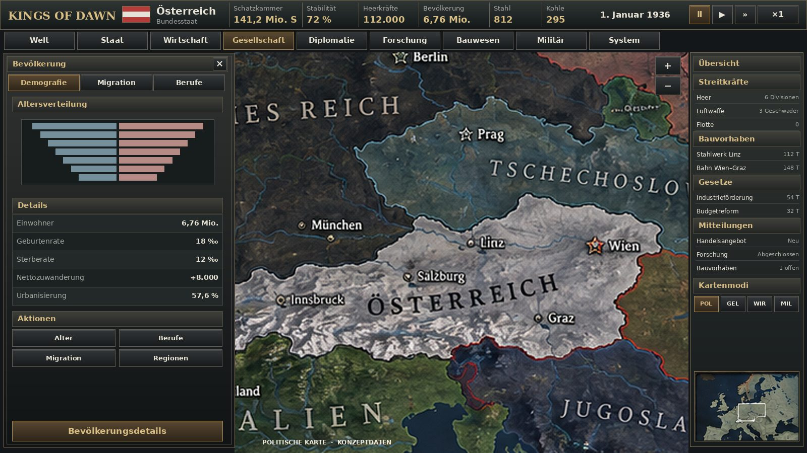

Kohorten nach Alter, Region, Bildung, Beruf, Kultur und Religion; Geburten, Tod, Wanderung, Urbanisierung, Arbeitskräfte, Einkommen, Vermögen und Lebensstandard.

**Datenmodell:** PopulationCohort, DemographicFlow, Household, MigrationFlow

**UI-Mockup-Referenz:** HTML, F-19; Elemente: Einwohner; Altersstruktur; Geburten/Tod; Migration; Arbeitskräfte

**Abnahme:** Bevölkerungsbilanz stimmt pro Tick; keine negativen Kohorten; Binnenmigration hebt sich national auf; Werte sind geschätzt/erhoben markiert.

**Prompt:**

Setze das Modul 19 – Bevölkerung, Demografie und Migration für KINGS OF DAWN um. Phase: MVP. Verwende den globalen Projektauftrag und die gemeinsame Architektur. Nutze die zugehörige High-Fidelity-Referenz als verbindliche visuelle Basis: feste HUD-Positionen, gleiche Kartenkamera, Messingrahmen und dunkle Stahlpanels, seitlicher Outliner, Minikarte, modulspezifische Controls; implementiere skalierbare UMG/Slate-Komponenten, keine bloße Screenshot-Oberfläche. Nutze verbindlich UE5; implementiere die Fachlogik bevorzugt im Rust-Core, die erforderlichen Engine-Adapter in C++ und die Oberfläche in UMG/Slate. Nutze das KingsOfDawnSimulation-Plugin und die versionierte C-ABI mit Commands und Snapshot-/Delta-Queries. Rein präsentationsbezogene Funktionen bleiben in Unreal; dupliziere keine Simulationslogik. Ergänze Rust-Tests und bei UE-Integration Unreal-Automation-Tests. Die Oberfläche und alle ViewModels müssen die definierte Designrichtung "modernes HOI4" einhalten: dunkle Grand-Strategy-Panels, Kartenfokus, obere Statusleisten, Seiteninspektoren, warme Metall-/Goldakzente, hohe Informationsdichte und zugleich modernisierte Lesbarkeit sowie UX. Fachlicher Umfang: Kohorten nach Alter, Region, Bildung, Beruf, Kultur und Religion; Geburten, Tod, Wanderung, Urbanisierung, Arbeitskräfte, Einkommen, Vermögen und Lebensstandard. Datenmodell: PopulationCohort, DemographicFlow, Household, MigrationFlow. Baue die Oberfläche nach dem zugehörigen Mockup mit folgenden Bedienelementen: Einwohner; Altersstruktur; Geburten/Tod; Migration; Arbeitskräfte. Abhängigkeiten: 04,05,16. Definiere typisierte Commands, read-only Queries, Domain-Events, Validierung, Transaktionen und Fehler-/Leerzustände. Implementiere die Funktion im Simulationskern und verbinde sie mit der UI; keine rein visuellen Platzhalter. Prüfe Epochenregeln, Realismus-/Sandbox-Berechtigungen und Save-Kompatibilität, soweit relevant. Abnahme: Bevölkerungsbilanz stimmt pro Tick; keine negativen Kohorten; Binnenmigration hebt sich national auf; Werte sind geschätzt/erhoben markiert. Liefere Unit- und Integrationstests, UI-Smoke-Test, Seed-Fixture, Dokumentation und eine kurze Liste der verbleibenden Einschränkungen. Nutze aggregierte Kohorten mit deterministischer Rundung; validiere Migration über Sender- und Empfängerregion.

### F-20 – Kultur, Religion und Sprache (V1)

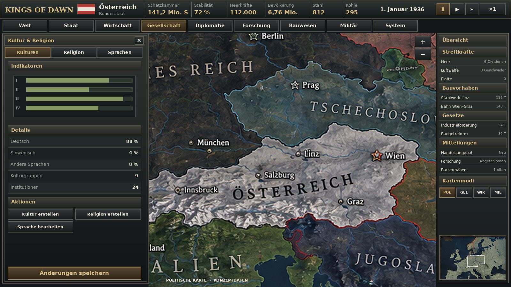

Kulturen, Sprachen, Religionen, Traditionen, Institutionen und Feiertage frei definieren; Verbreitung, Integration, Mehrsprachigkeit und Religionsfreiheit als dynamische Prozesse.

**Datenmodell:** Culture, Language, Religion, Institution, AffiliationShare

**UI-Mockup-Referenz:** HTML, F-20; Elemente: Kultur erstellen; Religion; Sprachanteile; Institutionen; Feiertage

**Abnahme:** Mehrfachzugehörigkeit möglich; Änderungen von Identitäten nur über nachvollziehbare Prozesse; keine unveränderlichen pauschalen Leistungswerte für Gruppen.

**Prompt:**

Setze das Modul 20 – Kultur, Religion und Sprache für KINGS OF DAWN um. Phase: V1. Verwende den globalen Projektauftrag und die gemeinsame Architektur. Nutze die zugehörige High-Fidelity-Referenz als verbindliche visuelle Basis: feste HUD-Positionen, gleiche Kartenkamera, Messingrahmen und dunkle Stahlpanels, seitlicher Outliner, Minikarte, modulspezifische Controls; implementiere skalierbare UMG/Slate-Komponenten, keine bloße Screenshot-Oberfläche. Nutze verbindlich UE5; implementiere die Fachlogik bevorzugt im Rust-Core, die erforderlichen Engine-Adapter in C++ und die Oberfläche in UMG/Slate. Nutze das KingsOfDawnSimulation-Plugin und die versionierte C-ABI mit Commands und Snapshot-/Delta-Queries. Rein präsentationsbezogene Funktionen bleiben in Unreal; dupliziere keine Simulationslogik. Ergänze Rust-Tests und bei UE-Integration Unreal-Automation-Tests. Die Oberfläche und alle ViewModels müssen die definierte Designrichtung "modernes HOI4" einhalten: dunkle Grand-Strategy-Panels, Kartenfokus, obere Statusleisten, Seiteninspektoren, warme Metall-/Goldakzente, hohe Informationsdichte und zugleich modernisierte Lesbarkeit sowie UX. Fachlicher Umfang: Kulturen, Sprachen, Religionen, Traditionen, Institutionen und Feiertage frei definieren; Verbreitung, Integration, Mehrsprachigkeit und Religionsfreiheit als dynamische Prozesse. Datenmodell: Culture, Language, Religion, Institution, AffiliationShare. Baue die Oberfläche nach dem zugehörigen Mockup mit folgenden Bedienelementen: Kultur erstellen; Religion; Sprachanteile; Institutionen; Feiertage. Abhängigkeiten: 10,19. Definiere typisierte Commands, read-only Queries, Domain-Events, Validierung, Transaktionen und Fehler-/Leerzustände. Implementiere die Funktion im Simulationskern und verbinde sie mit der UI; keine rein visuellen Platzhalter. Prüfe Epochenregeln, Realismus-/Sandbox-Berechtigungen und Save-Kompatibilität, soweit relevant. Abnahme: Mehrfachzugehörigkeit möglich; Änderungen von Identitäten nur über nachvollziehbare Prozesse; keine unveränderlichen pauschalen Leistungswerte für Gruppen. Liefere Unit- und Integrationstests, UI-Smoke-Test, Seed-Fixture, Dokumentation und eine kurze Liste der verbleibenden Einschränkungen. 

### F-21 – Städtebau, Wohnraum und Gebäude (MVP)

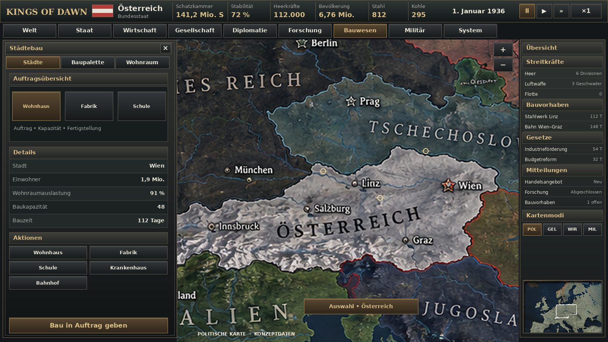

Städte/Dörfer platzieren und ausbauen, Wohnraum, Industrie, Verwaltung, Schulen, Krankenhäuser, Märkte, Monumente; Baukosten, Bauzeit, Landnutzung und Bevölkerungsbewegung.

**Datenmodell:** Settlement, Building, LandUse, ConstructionOrder, HousingStock

**UI-Mockup-Referenz:** HTML, F-21; Elemente: Stadtkarte; Einwohner; Wohnraum; Baupalette; Bauwarteschlange

**Abnahme:** Bauen kostet Ressourcen/Geld und dauert; Kapazität wird erst nach Fertigstellung verfügbar; keine Gebäude auf ungültigem Terrain.

**Prompt:**

Setze das Modul 21 – Städtebau, Wohnraum und Gebäude für KINGS OF DAWN um. Phase: MVP. Verwende den globalen Projektauftrag und die gemeinsame Architektur. Nutze die zugehörige High-Fidelity-Referenz als verbindliche visuelle Basis: feste HUD-Positionen, gleiche Kartenkamera, Messingrahmen und dunkle Stahlpanels, seitlicher Outliner, Minikarte, modulspezifische Controls; implementiere skalierbare UMG/Slate-Komponenten, keine bloße Screenshot-Oberfläche. Nutze verbindlich UE5; implementiere die Fachlogik bevorzugt im Rust-Core, die erforderlichen Engine-Adapter in C++ und die Oberfläche in UMG/Slate. Nutze das KingsOfDawnSimulation-Plugin und die versionierte C-ABI mit Commands und Snapshot-/Delta-Queries. Rein präsentationsbezogene Funktionen bleiben in Unreal; dupliziere keine Simulationslogik. Ergänze Rust-Tests und bei UE-Integration Unreal-Automation-Tests. Die Oberfläche und alle ViewModels müssen die definierte Designrichtung "modernes HOI4" einhalten: dunkle Grand-Strategy-Panels, Kartenfokus, obere Statusleisten, Seiteninspektoren, warme Metall-/Goldakzente, hohe Informationsdichte und zugleich modernisierte Lesbarkeit sowie UX. Fachlicher Umfang: Städte/Dörfer platzieren und ausbauen, Wohnraum, Industrie, Verwaltung, Schulen, Krankenhäuser, Märkte, Monumente; Baukosten, Bauzeit, Landnutzung und Bevölkerungsbewegung. Datenmodell: Settlement, Building, LandUse, ConstructionOrder, HousingStock. Baue die Oberfläche nach dem zugehörigen Mockup mit folgenden Bedienelementen: Stadtkarte; Einwohner; Wohnraum; Baupalette; Bauwarteschlange. Abhängigkeiten: 04,15,16,19. Definiere typisierte Commands, read-only Queries, Domain-Events, Validierung, Transaktionen und Fehler-/Leerzustände. Implementiere die Funktion im Simulationskern und verbinde sie mit der UI; keine rein visuellen Platzhalter. Prüfe Epochenregeln, Realismus-/Sandbox-Berechtigungen und Save-Kompatibilität, soweit relevant. Abnahme: Bauen kostet Ressourcen/Geld und dauert; Kapazität wird erst nach Fertigstellung verfügbar; keine Gebäude auf ungültigem Terrain. Liefere Unit- und Integrationstests, UI-Smoke-Test, Seed-Fixture, Dokumentation und eine kurze Liste der verbleibenden Einschränkungen. 

### F-22 – Verkehr, Energie und Versorgung (MVP)

Straßen, Schienen, Häfen, Flughäfen, Kanäle, Stromnetze und Wasser; Transportgraph, Kapazität, Engpässe, Energieerzeugung und Wartung; technologieabhängige Infrastruktur.

**Datenmodell:** NetworkNode, NetworkEdge, Flow, Utility, Capacity

**UI-Mockup-Referenz:** HTML, F-22; Elemente: Verkehrsnetz; Strom; Wasser; Engpass; Ausbau; Kosten

**Abnahme:** Fluss überschreitet keine Kapazität; Unterbrechung ändert Erreichbarkeit; moderne Netze erst mit passender Technologie.

**Prompt:**

Setze das Modul 22 – Verkehr, Energie und Versorgung für KINGS OF DAWN um. Phase: MVP. Verwende den globalen Projektauftrag und die gemeinsame Architektur. Nutze die zugehörige High-Fidelity-Referenz als verbindliche visuelle Basis: feste HUD-Positionen, gleiche Kartenkamera, Messingrahmen und dunkle Stahlpanels, seitlicher Outliner, Minikarte, modulspezifische Controls; implementiere skalierbare UMG/Slate-Komponenten, keine bloße Screenshot-Oberfläche. Nutze verbindlich UE5; implementiere die Fachlogik bevorzugt im Rust-Core, die erforderlichen Engine-Adapter in C++ und die Oberfläche in UMG/Slate. Nutze das KingsOfDawnSimulation-Plugin und die versionierte C-ABI mit Commands und Snapshot-/Delta-Queries. Rein präsentationsbezogene Funktionen bleiben in Unreal; dupliziere keine Simulationslogik. Ergänze Rust-Tests und bei UE-Integration Unreal-Automation-Tests. Die Oberfläche und alle ViewModels müssen die definierte Designrichtung "modernes HOI4" einhalten: dunkle Grand-Strategy-Panels, Kartenfokus, obere Statusleisten, Seiteninspektoren, warme Metall-/Goldakzente, hohe Informationsdichte und zugleich modernisierte Lesbarkeit sowie UX. Fachlicher Umfang: Straßen, Schienen, Häfen, Flughäfen, Kanäle, Stromnetze und Wasser; Transportgraph, Kapazität, Engpässe, Energieerzeugung und Wartung; technologieabhängige Infrastruktur. Datenmodell: NetworkNode, NetworkEdge, Flow, Utility, Capacity. Baue die Oberfläche nach dem zugehörigen Mockup mit folgenden Bedienelementen: Verkehrsnetz; Strom; Wasser; Engpass; Ausbau; Kosten. Abhängigkeiten: 21,16. Definiere typisierte Commands, read-only Queries, Domain-Events, Validierung, Transaktionen und Fehler-/Leerzustände. Implementiere die Funktion im Simulationskern und verbinde sie mit der UI; keine rein visuellen Platzhalter. Prüfe Epochenregeln, Realismus-/Sandbox-Berechtigungen und Save-Kompatibilität, soweit relevant. Abnahme: Fluss überschreitet keine Kapazität; Unterbrechung ändert Erreichbarkeit; moderne Netze erst mit passender Technologie. Liefere Unit- und Integrationstests, UI-Smoke-Test, Seed-Fixture, Dokumentation und eine kurze Liste der verbleibenden Einschränkungen. 

### F-23 – Bildung, Gesundheit und Sozialstaat (V1)

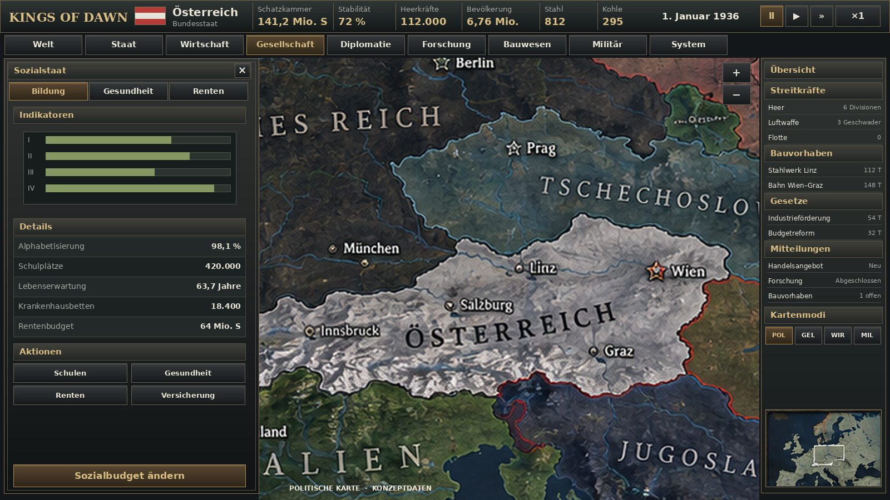

Schulen, Universitäten, Alphabetisierung, Ausbildung, Gesundheitssystem, Epidemien, Renten und Sozialleistungen; Versorgung über Budget, Personal, Infrastruktur und Zugang.

**Datenmodell:** EducationLevel, HealthCapacity, Benefit, EpidemicModel, Pension

**UI-Mockup-Referenz:** HTML, F-23; Elemente: Alphabetisierung; Schulplätze; Gesundheit; Rentenbudget; Leistung

**Abnahme:** Leistungen benötigen Finanzierung; Bildung wirkt zeitverzögert; Gesundheit beeinflusst Sterblichkeit ohne deterministische Einzelfallvorhersagen.

**Prompt:**

Setze das Modul 23 – Bildung, Gesundheit und Sozialstaat für KINGS OF DAWN um. Phase: V1. Verwende den globalen Projektauftrag und die gemeinsame Architektur. Nutze die zugehörige High-Fidelity-Referenz als verbindliche visuelle Basis: feste HUD-Positionen, gleiche Kartenkamera, Messingrahmen und dunkle Stahlpanels, seitlicher Outliner, Minikarte, modulspezifische Controls; implementiere skalierbare UMG/Slate-Komponenten, keine bloße Screenshot-Oberfläche. Nutze verbindlich UE5; implementiere die Fachlogik bevorzugt im Rust-Core, die erforderlichen Engine-Adapter in C++ und die Oberfläche in UMG/Slate. Nutze das KingsOfDawnSimulation-Plugin und die versionierte C-ABI mit Commands und Snapshot-/Delta-Queries. Rein präsentationsbezogene Funktionen bleiben in Unreal; dupliziere keine Simulationslogik. Ergänze Rust-Tests und bei UE-Integration Unreal-Automation-Tests. Die Oberfläche und alle ViewModels müssen die definierte Designrichtung "modernes HOI4" einhalten: dunkle Grand-Strategy-Panels, Kartenfokus, obere Statusleisten, Seiteninspektoren, warme Metall-/Goldakzente, hohe Informationsdichte und zugleich modernisierte Lesbarkeit sowie UX. Fachlicher Umfang: Schulen, Universitäten, Alphabetisierung, Ausbildung, Gesundheitssystem, Epidemien, Renten und Sozialleistungen; Versorgung über Budget, Personal, Infrastruktur und Zugang. Datenmodell: EducationLevel, HealthCapacity, Benefit, EpidemicModel, Pension. Baue die Oberfläche nach dem zugehörigen Mockup mit folgenden Bedienelementen: Alphabetisierung; Schulplätze; Gesundheit; Rentenbudget; Leistung. Abhängigkeiten: 12,15,19,21. Definiere typisierte Commands, read-only Queries, Domain-Events, Validierung, Transaktionen und Fehler-/Leerzustände. Implementiere die Funktion im Simulationskern und verbinde sie mit der UI; keine rein visuellen Platzhalter. Prüfe Epochenregeln, Realismus-/Sandbox-Berechtigungen und Save-Kompatibilität, soweit relevant. Abnahme: Leistungen benötigen Finanzierung; Bildung wirkt zeitverzögert; Gesundheit beeinflusst Sterblichkeit ohne deterministische Einzelfallvorhersagen. Liefere Unit- und Integrationstests, UI-Smoke-Test, Seed-Fixture, Dokumentation und eine kurze Liste der verbleibenden Einschränkungen. 

### F-24 – Öffentliche Meinung, Medien und Unruhen (V1)

Interessengruppen, Gewerkschaften, Medienlandschaft, Vertrauen, Proteste, Streiks, Revolutionen und politische Krisen; Meinungen reagieren auf reale Lebensbedingungen und Ereignisse.

**Datenmodell:** InterestGroup, OpinionVector, MediaOutlet, Protest, Legitimacy

**UI-Mockup-Referenz:** HTML, F-24; Elemente: Zufriedenheit; Gruppen; Forderungen; Streiks; Legitimität

**Abnahme:** Proteste entstehen aus modellierten Ursachen; Veränderungen erklärbar; keine Gruppe reagiert immer identisch; Eskalation und Deeskalation möglich.

**Prompt:**

Setze das Modul 24 – Öffentliche Meinung, Medien und Unruhen für KINGS OF DAWN um. Phase: V1. Verwende den globalen Projektauftrag und die gemeinsame Architektur. Nutze die zugehörige High-Fidelity-Referenz als verbindliche visuelle Basis: feste HUD-Positionen, gleiche Kartenkamera, Messingrahmen und dunkle Stahlpanels, seitlicher Outliner, Minikarte, modulspezifische Controls; implementiere skalierbare UMG/Slate-Komponenten, keine bloße Screenshot-Oberfläche. Nutze verbindlich UE5; implementiere die Fachlogik bevorzugt im Rust-Core, die erforderlichen Engine-Adapter in C++ und die Oberfläche in UMG/Slate. Nutze das KingsOfDawnSimulation-Plugin und die versionierte C-ABI mit Commands und Snapshot-/Delta-Queries. Rein präsentationsbezogene Funktionen bleiben in Unreal; dupliziere keine Simulationslogik. Ergänze Rust-Tests und bei UE-Integration Unreal-Automation-Tests. Die Oberfläche und alle ViewModels müssen die definierte Designrichtung "modernes HOI4" einhalten: dunkle Grand-Strategy-Panels, Kartenfokus, obere Statusleisten, Seiteninspektoren, warme Metall-/Goldakzente, hohe Informationsdichte und zugleich modernisierte Lesbarkeit sowie UX. Fachlicher Umfang: Interessengruppen, Gewerkschaften, Medienlandschaft, Vertrauen, Proteste, Streiks, Revolutionen und politische Krisen; Meinungen reagieren auf reale Lebensbedingungen und Ereignisse. Datenmodell: InterestGroup, OpinionVector, MediaOutlet, Protest, Legitimacy. Baue die Oberfläche nach dem zugehörigen Mockup mit folgenden Bedienelementen: Zufriedenheit; Gruppen; Forderungen; Streiks; Legitimität. Abhängigkeiten: 10,11,19,23. Definiere typisierte Commands, read-only Queries, Domain-Events, Validierung, Transaktionen und Fehler-/Leerzustände. Implementiere die Funktion im Simulationskern und verbinde sie mit der UI; keine rein visuellen Platzhalter. Prüfe Epochenregeln, Realismus-/Sandbox-Berechtigungen und Save-Kompatibilität, soweit relevant. Abnahme: Proteste entstehen aus modellierten Ursachen; Veränderungen erklärbar; keine Gruppe reagiert immer identisch; Eskalation und Deeskalation möglich. Liefere Unit- und Integrationstests, UI-Smoke-Test, Seed-Fixture, Dokumentation und eine kurze Liste der verbleibenden Einschränkungen. 

### F-25 – Umwelt, Klima und Landwirtschaft (V1)

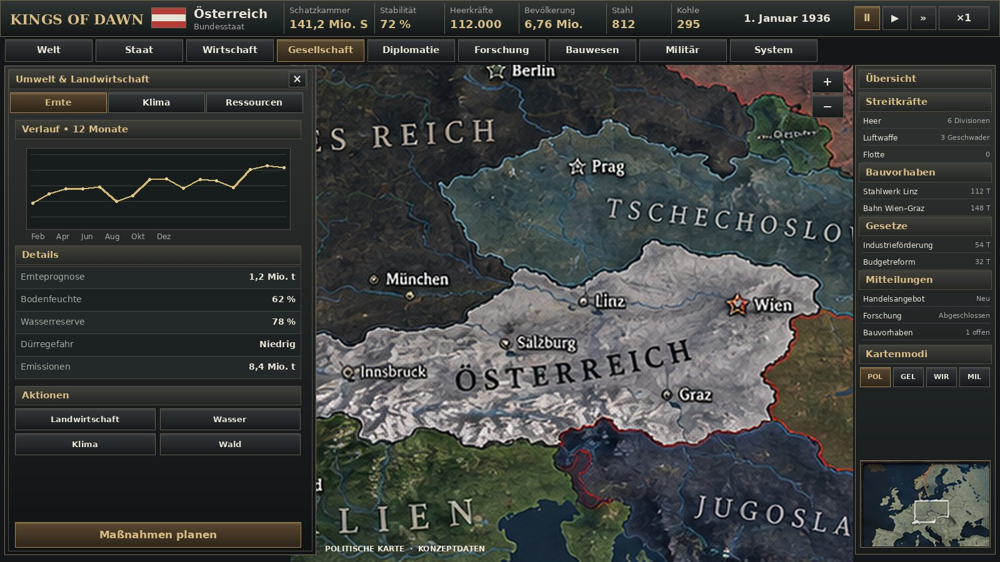

Wetter, Ernte, Bodenfruchtbarkeit, Wasser, Wald, Ressourcenerschöpfung, Verschmutzung, Naturkatastrophen und nachhaltige Maßnahmen; Epochenabhängigkeit und Unsicherheit.

**Datenmodell:** ClimateCell, Crop, WaterBalance, Pollution, Disaster

**UI-Mockup-Referenz:** HTML, F-25; Elemente: Ernteprognose; Dürre; Emissionen; Wasser; Schutzgebiete

**Abnahme:** Ernteschock verändert Marktangebot; Ressourcen können erschöpfen; Wetter generiert sich deterministisch aus Seed; keine modernen Emissionswerte als historische Fakten.

**Prompt:**

Setze das Modul 25 – Umwelt, Klima und Landwirtschaft für KINGS OF DAWN um. Phase: V1. Verwende den globalen Projektauftrag und die gemeinsame Architektur. Nutze die zugehörige High-Fidelity-Referenz als verbindliche visuelle Basis: feste HUD-Positionen, gleiche Kartenkamera, Messingrahmen und dunkle Stahlpanels, seitlicher Outliner, Minikarte, modulspezifische Controls; implementiere skalierbare UMG/Slate-Komponenten, keine bloße Screenshot-Oberfläche. Nutze verbindlich UE5; implementiere die Fachlogik bevorzugt im Rust-Core, die erforderlichen Engine-Adapter in C++ und die Oberfläche in UMG/Slate. Nutze das KingsOfDawnSimulation-Plugin und die versionierte C-ABI mit Commands und Snapshot-/Delta-Queries. Rein präsentationsbezogene Funktionen bleiben in Unreal; dupliziere keine Simulationslogik. Ergänze Rust-Tests und bei UE-Integration Unreal-Automation-Tests. Die Oberfläche und alle ViewModels müssen die definierte Designrichtung "modernes HOI4" einhalten: dunkle Grand-Strategy-Panels, Kartenfokus, obere Statusleisten, Seiteninspektoren, warme Metall-/Goldakzente, hohe Informationsdichte und zugleich modernisierte Lesbarkeit sowie UX. Fachlicher Umfang: Wetter, Ernte, Bodenfruchtbarkeit, Wasser, Wald, Ressourcenerschöpfung, Verschmutzung, Naturkatastrophen und nachhaltige Maßnahmen; Epochenabhängigkeit und Unsicherheit. Datenmodell: ClimateCell, Crop, WaterBalance, Pollution, Disaster. Baue die Oberfläche nach dem zugehörigen Mockup mit folgenden Bedienelementen: Ernteprognose; Dürre; Emissionen; Wasser; Schutzgebiete. Abhängigkeiten: 16,19,21. Definiere typisierte Commands, read-only Queries, Domain-Events, Validierung, Transaktionen und Fehler-/Leerzustände. Implementiere die Funktion im Simulationskern und verbinde sie mit der UI; keine rein visuellen Platzhalter. Prüfe Epochenregeln, Realismus-/Sandbox-Berechtigungen und Save-Kompatibilität, soweit relevant. Abnahme: Ernteschock verändert Marktangebot; Ressourcen können erschöpfen; Wetter generiert sich deterministisch aus Seed; keine modernen Emissionswerte als historische Fakten. Liefere Unit- und Integrationstests, UI-Smoke-Test, Seed-Fixture, Dokumentation und eine kurze Liste der verbleibenden Einschränkungen. 

### F-26 – Forschung, Erfindungen und Wissenstransfer (V1)

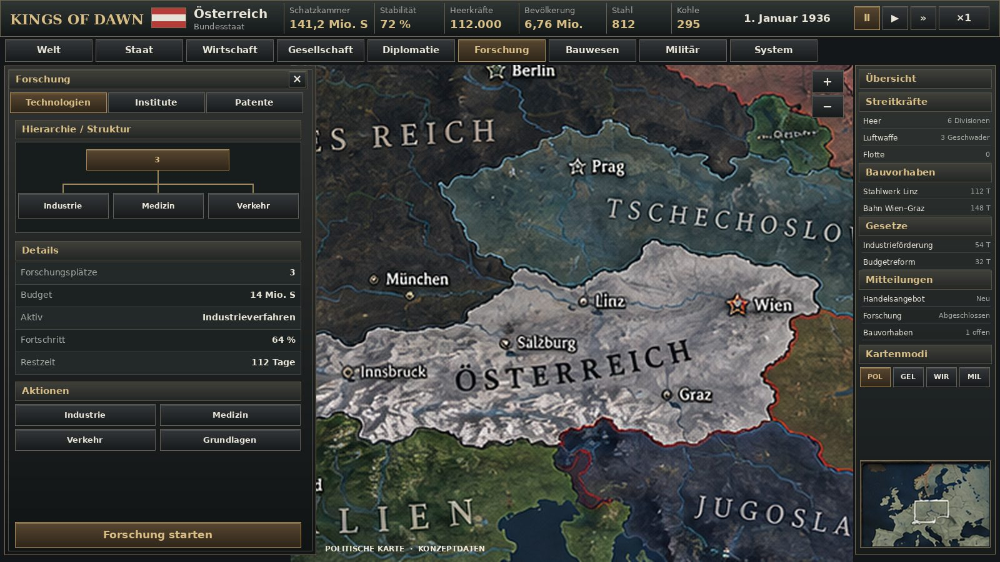

Datengetriebener Technologiegraph mit Voraussetzungen, Forschungskosten, Zeit, Institutionen, Verbreitung und Patenten; unterschiedliche Entwicklungspfade von Antike bis Zukunft.

**Datenmodell:** Technology, Prerequisite, ResearchProject, KnowledgeDiffusion, Patent

**UI-Mockup-Referenz:** HTML, F-26; Elemente: Technologiebaum; Eisenverarbeitung; Dampfmaschine; Forschung; Fortschritt

**Abnahme:** Keine Zyklen im Voraussetzungsgraph; Freischaltung nur bei Voraussetzungen; Alternativgeschichte erlaubt frühe Erfindung bei erfüllten Bedingungen.

**Prompt:**

Setze das Modul 26 – Forschung, Erfindungen und Wissenstransfer für KINGS OF DAWN um. Phase: V1. Verwende den globalen Projektauftrag und die gemeinsame Architektur. Nutze die zugehörige High-Fidelity-Referenz als verbindliche visuelle Basis: feste HUD-Positionen, gleiche Kartenkamera, Messingrahmen und dunkle Stahlpanels, seitlicher Outliner, Minikarte, modulspezifische Controls; implementiere skalierbare UMG/Slate-Komponenten, keine bloße Screenshot-Oberfläche. Nutze verbindlich UE5; implementiere die Fachlogik bevorzugt im Rust-Core, die erforderlichen Engine-Adapter in C++ und die Oberfläche in UMG/Slate. Nutze das KingsOfDawnSimulation-Plugin und die versionierte C-ABI mit Commands und Snapshot-/Delta-Queries. Rein präsentationsbezogene Funktionen bleiben in Unreal; dupliziere keine Simulationslogik. Ergänze Rust-Tests und bei UE-Integration Unreal-Automation-Tests. Die Oberfläche und alle ViewModels müssen die definierte Designrichtung "modernes HOI4" einhalten: dunkle Grand-Strategy-Panels, Kartenfokus, obere Statusleisten, Seiteninspektoren, warme Metall-/Goldakzente, hohe Informationsdichte und zugleich modernisierte Lesbarkeit sowie UX. Fachlicher Umfang: Datengetriebener Technologiegraph mit Voraussetzungen, Forschungskosten, Zeit, Institutionen, Verbreitung und Patenten; unterschiedliche Entwicklungspfade von Antike bis Zukunft. Datenmodell: Technology, Prerequisite, ResearchProject, KnowledgeDiffusion, Patent. Baue die Oberfläche nach dem zugehörigen Mockup mit folgenden Bedienelementen: Technologiebaum; Eisenverarbeitung; Dampfmaschine; Forschung; Fortschritt. Abhängigkeiten: 17,23. Definiere typisierte Commands, read-only Queries, Domain-Events, Validierung, Transaktionen und Fehler-/Leerzustände. Implementiere die Funktion im Simulationskern und verbinde sie mit der UI; keine rein visuellen Platzhalter. Prüfe Epochenregeln, Realismus-/Sandbox-Berechtigungen und Save-Kompatibilität, soweit relevant. Abnahme: Keine Zyklen im Voraussetzungsgraph; Freischaltung nur bei Voraussetzungen; Alternativgeschichte erlaubt frühe Erfindung bei erfüllten Bedingungen. Liefere Unit- und Integrationstests, UI-Smoke-Test, Seed-Fixture, Dokumentation und eine kurze Liste der verbleibenden Einschränkungen. 

### F-27 – Beziehungen, Anerkennung und Verhandlungen (MVP)

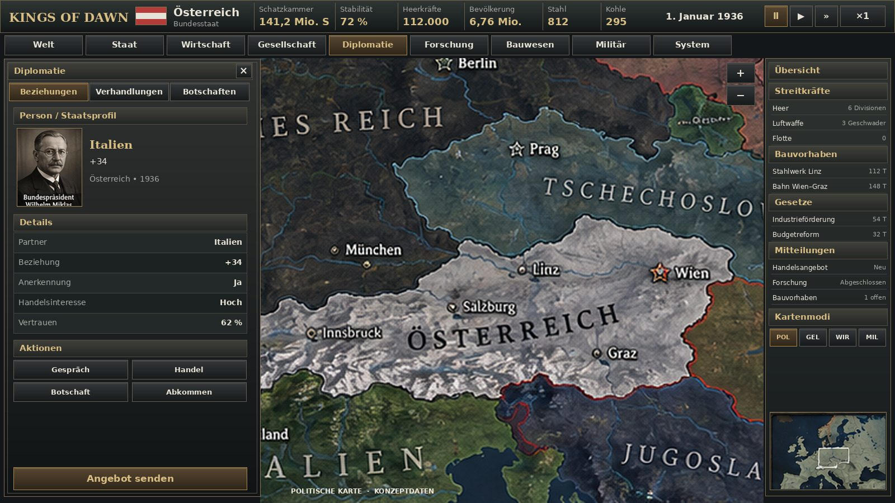

Botschaften, Gesandte, Anerkennung, Beziehungen, Forderungen, Gegenangebote, Grenzstreitigkeiten und diplomatische Krisen; Verhandlung über strukturierte Angebote.

**Datenmodell:** DiplomaticRelation, Recognition, Embassy, Proposal, Negotiation

**UI-Mockup-Referenz:** HTML, F-27; Elemente: Partner; Beziehung; Anerkennung; Angebot; Gegenangebot; Antwort

**Abnahme:** Einseitige Angebote sind nicht bindend; Annahme prüft Berechtigung; diplomatischer Status beeinflusst Handel und Verträge.

**Prompt:**

Setze das Modul 27 – Beziehungen, Anerkennung und Verhandlungen für KINGS OF DAWN um. Phase: MVP. Verwende den globalen Projektauftrag und die gemeinsame Architektur. Nutze die zugehörige High-Fidelity-Referenz als verbindliche visuelle Basis: feste HUD-Positionen, gleiche Kartenkamera, Messingrahmen und dunkle Stahlpanels, seitlicher Outliner, Minikarte, modulspezifische Controls; implementiere skalierbare UMG/Slate-Komponenten, keine bloße Screenshot-Oberfläche. Nutze verbindlich UE5; implementiere die Fachlogik bevorzugt im Rust-Core, die erforderlichen Engine-Adapter in C++ und die Oberfläche in UMG/Slate. Nutze das KingsOfDawnSimulation-Plugin und die versionierte C-ABI mit Commands und Snapshot-/Delta-Queries. Rein präsentationsbezogene Funktionen bleiben in Unreal; dupliziere keine Simulationslogik. Ergänze Rust-Tests und bei UE-Integration Unreal-Automation-Tests. Die Oberfläche und alle ViewModels müssen die definierte Designrichtung "modernes HOI4" einhalten: dunkle Grand-Strategy-Panels, Kartenfokus, obere Statusleisten, Seiteninspektoren, warme Metall-/Goldakzente, hohe Informationsdichte und zugleich modernisierte Lesbarkeit sowie UX. Fachlicher Umfang: Botschaften, Gesandte, Anerkennung, Beziehungen, Forderungen, Gegenangebote, Grenzstreitigkeiten und diplomatische Krisen; Verhandlung über strukturierte Angebote. Datenmodell: DiplomaticRelation, Recognition, Embassy, Proposal, Negotiation. Baue die Oberfläche nach dem zugehörigen Mockup mit folgenden Bedienelementen: Partner; Beziehung; Anerkennung; Angebot; Gegenangebot; Antwort. Abhängigkeiten: 05,08. Definiere typisierte Commands, read-only Queries, Domain-Events, Validierung, Transaktionen und Fehler-/Leerzustände. Implementiere die Funktion im Simulationskern und verbinde sie mit der UI; keine rein visuellen Platzhalter. Prüfe Epochenregeln, Realismus-/Sandbox-Berechtigungen und Save-Kompatibilität, soweit relevant. Abnahme: Einseitige Angebote sind nicht bindend; Annahme prüft Berechtigung; diplomatischer Status beeinflusst Handel und Verträge. Liefere Unit- und Integrationstests, UI-Smoke-Test, Seed-Fixture, Dokumentation und eine kurze Liste der verbleibenden Einschränkungen. 

### F-28 – Verträge, Bündnisse und internationale Organisationen (V1)

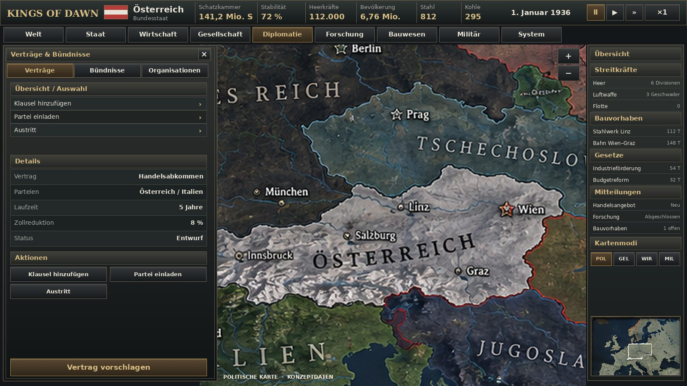

Individuelle Vertragsklauseln zu Handel, Bündnissen, Nichtangriff, Rechten, Mitgliedsbeiträgen, gemeinsamen Währungen und Schlichtung; Laufzeit, Ratifikation, Kündigung und Vertragsbruch.

**Datenmodell:** Treaty, TreatyClause, Alliance, Organization, Membership, Ratification

**UI-Mockup-Referenz:** HTML, F-28; Elemente: Vertragstitel; Parteien; Klauseln; Laufzeit; ratifizieren

**Abnahme:** Vertrag wird erst nach erforderlicher Zustimmung wirksam; abgelaufene Klauseln enden; Vertragsbruch wird dokumentiert und wirkt auf Beziehungen.

**Prompt:**

Setze das Modul 28 – Verträge, Bündnisse und internationale Organisationen für KINGS OF DAWN um. Phase: V1. Verwende den globalen Projektauftrag und die gemeinsame Architektur. Nutze die zugehörige High-Fidelity-Referenz als verbindliche visuelle Basis: feste HUD-Positionen, gleiche Kartenkamera, Messingrahmen und dunkle Stahlpanels, seitlicher Outliner, Minikarte, modulspezifische Controls; implementiere skalierbare UMG/Slate-Komponenten, keine bloße Screenshot-Oberfläche. Nutze verbindlich UE5; implementiere die Fachlogik bevorzugt im Rust-Core, die erforderlichen Engine-Adapter in C++ und die Oberfläche in UMG/Slate. Nutze das KingsOfDawnSimulation-Plugin und die versionierte C-ABI mit Commands und Snapshot-/Delta-Queries. Rein präsentationsbezogene Funktionen bleiben in Unreal; dupliziere keine Simulationslogik. Ergänze Rust-Tests und bei UE-Integration Unreal-Automation-Tests. Die Oberfläche und alle ViewModels müssen die definierte Designrichtung "modernes HOI4" einhalten: dunkle Grand-Strategy-Panels, Kartenfokus, obere Statusleisten, Seiteninspektoren, warme Metall-/Goldakzente, hohe Informationsdichte und zugleich modernisierte Lesbarkeit sowie UX. Fachlicher Umfang: Individuelle Vertragsklauseln zu Handel, Bündnissen, Nichtangriff, Rechten, Mitgliedsbeiträgen, gemeinsamen Währungen und Schlichtung; Laufzeit, Ratifikation, Kündigung und Vertragsbruch. Datenmodell: Treaty, TreatyClause, Alliance, Organization, Membership, Ratification. Baue die Oberfläche nach dem zugehörigen Mockup mit folgenden Bedienelementen: Vertragstitel; Parteien; Klauseln; Laufzeit; ratifizieren. Abhängigkeiten: 10,27. Definiere typisierte Commands, read-only Queries, Domain-Events, Validierung, Transaktionen und Fehler-/Leerzustände. Implementiere die Funktion im Simulationskern und verbinde sie mit der UI; keine rein visuellen Platzhalter. Prüfe Epochenregeln, Realismus-/Sandbox-Berechtigungen und Save-Kompatibilität, soweit relevant. Abnahme: Vertrag wird erst nach erforderlicher Zustimmung wirksam; abgelaufene Klauseln enden; Vertragsbruch wird dokumentiert und wirkt auf Beziehungen. Liefere Unit- und Integrationstests, UI-Smoke-Test, Seed-Fixture, Dokumentation und eine kurze Liste der verbleibenden Einschränkungen. 

### F-29 – Streitkräfte, Organisation und Personal (V1)

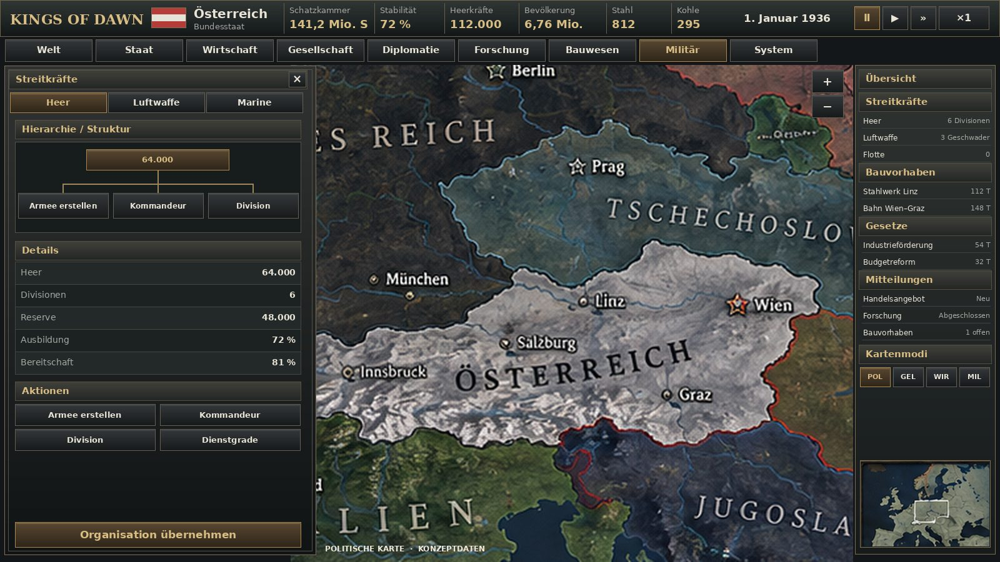

Land-, See- und Luftkräfte je Epoche, Dienstgrade, Uniformen, Einheitenstruktur, Rekrutierung, Ausbildung, Reserven und Offizierskarrieren; historisch passende Rollen und Materialklassen.

**Datenmodell:** ServiceBranch, Formation, UnitTemplate, Rank, RecruitPool

**UI-Mockup-Referenz:** HTML, F-29; Elemente: Armee; Hierarchie; Personal; Ausbildung; Reserve; Einheit erstellen

**Abnahme:** Rekrutierung reduziert verfügbaren Arbeitskräftepool; Einheiten benötigen Ausrüstung und Unterhalt; Hierarchie ist zyklenfrei.

**Prompt:**

Setze das Modul 29 – Streitkräfte, Organisation und Personal für KINGS OF DAWN um. Phase: V1. Verwende den globalen Projektauftrag und die gemeinsame Architektur. Nutze die zugehörige High-Fidelity-Referenz als verbindliche visuelle Basis: feste HUD-Positionen, gleiche Kartenkamera, Messingrahmen und dunkle Stahlpanels, seitlicher Outliner, Minikarte, modulspezifische Controls; implementiere skalierbare UMG/Slate-Komponenten, keine bloße Screenshot-Oberfläche. Nutze verbindlich UE5; implementiere die Fachlogik bevorzugt im Rust-Core, die erforderlichen Engine-Adapter in C++ und die Oberfläche in UMG/Slate. Nutze das KingsOfDawnSimulation-Plugin und die versionierte C-ABI mit Commands und Snapshot-/Delta-Queries. Rein präsentationsbezogene Funktionen bleiben in Unreal; dupliziere keine Simulationslogik. Ergänze Rust-Tests und bei UE-Integration Unreal-Automation-Tests. Die Oberfläche und alle ViewModels müssen die definierte Designrichtung "modernes HOI4" einhalten: dunkle Grand-Strategy-Panels, Kartenfokus, obere Statusleisten, Seiteninspektoren, warme Metall-/Goldakzente, hohe Informationsdichte und zugleich modernisierte Lesbarkeit sowie UX. Fachlicher Umfang: Land-, See- und Luftkräfte je Epoche, Dienstgrade, Uniformen, Einheitenstruktur, Rekrutierung, Ausbildung, Reserven und Offizierskarrieren; historisch passende Rollen und Materialklassen. Datenmodell: ServiceBranch, Formation, UnitTemplate, Rank, RecruitPool. Baue die Oberfläche nach dem zugehörigen Mockup mit folgenden Bedienelementen: Armee; Hierarchie; Personal; Ausbildung; Reserve; Einheit erstellen. Abhängigkeiten: 08,19,26. Definiere typisierte Commands, read-only Queries, Domain-Events, Validierung, Transaktionen und Fehler-/Leerzustände. Implementiere die Funktion im Simulationskern und verbinde sie mit der UI; keine rein visuellen Platzhalter. Prüfe Epochenregeln, Realismus-/Sandbox-Berechtigungen und Save-Kompatibilität, soweit relevant. Abnahme: Rekrutierung reduziert verfügbaren Arbeitskräftepool; Einheiten benötigen Ausrüstung und Unterhalt; Hierarchie ist zyklenfrei. Liefere Unit- und Integrationstests, UI-Smoke-Test, Seed-Fixture, Dokumentation und eine kurze Liste der verbleibenden Einschränkungen. 

### F-30 – Ausrüstung, Rüstung und Militärdoktrin (V1)

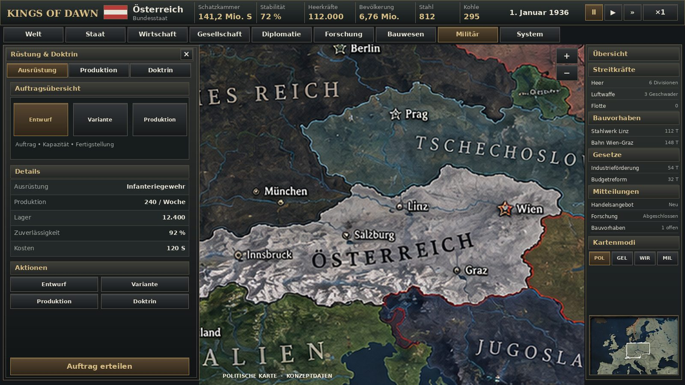

Abstrakter Ausrüstungseditor mit epochengebundenen Kategorien, Kosten, Zuverlässigkeit, Versorgung, Produktionsbedarf und Einsatzrolle; Doktrinen beeinflussen simulierte Formationseigenschaften.

**Datenmodell:** EquipmentType, DesignVariant, Doctrine, Procurement, Stockpile

**UI-Mockup-Referenz:** HTML, F-30; Elemente: Ausrüstungsklasse; Kosten; Zuverlässigkeit; Produktionsauftrag; Doktrin

**Abnahme:** Forschung und Ressourcen begrenzen Varianten; Produktion erzeugt Lagerbestand; keine unrealistischen Einheiten ohne Inputs; abstrakte Spielwerte statt realer Bauanleitungen.

**Prompt:**

Setze das Modul 30 – Ausrüstung, Rüstung und Militärdoktrin für KINGS OF DAWN um. Phase: V1. Verwende den globalen Projektauftrag und die gemeinsame Architektur. Nutze die zugehörige High-Fidelity-Referenz als verbindliche visuelle Basis: feste HUD-Positionen, gleiche Kartenkamera, Messingrahmen und dunkle Stahlpanels, seitlicher Outliner, Minikarte, modulspezifische Controls; implementiere skalierbare UMG/Slate-Komponenten, keine bloße Screenshot-Oberfläche. Nutze verbindlich UE5; implementiere die Fachlogik bevorzugt im Rust-Core, die erforderlichen Engine-Adapter in C++ und die Oberfläche in UMG/Slate. Nutze das KingsOfDawnSimulation-Plugin und die versionierte C-ABI mit Commands und Snapshot-/Delta-Queries. Rein präsentationsbezogene Funktionen bleiben in Unreal; dupliziere keine Simulationslogik. Ergänze Rust-Tests und bei UE-Integration Unreal-Automation-Tests. Die Oberfläche und alle ViewModels müssen die definierte Designrichtung "modernes HOI4" einhalten: dunkle Grand-Strategy-Panels, Kartenfokus, obere Statusleisten, Seiteninspektoren, warme Metall-/Goldakzente, hohe Informationsdichte und zugleich modernisierte Lesbarkeit sowie UX. Fachlicher Umfang: Abstrakter Ausrüstungseditor mit epochengebundenen Kategorien, Kosten, Zuverlässigkeit, Versorgung, Produktionsbedarf und Einsatzrolle; Doktrinen beeinflussen simulierte Formationseigenschaften. Datenmodell: EquipmentType, DesignVariant, Doctrine, Procurement, Stockpile. Baue die Oberfläche nach dem zugehörigen Mockup mit folgenden Bedienelementen: Ausrüstungsklasse; Kosten; Zuverlässigkeit; Produktionsauftrag; Doktrin. Abhängigkeiten: 17,26,29. Definiere typisierte Commands, read-only Queries, Domain-Events, Validierung, Transaktionen und Fehler-/Leerzustände. Implementiere die Funktion im Simulationskern und verbinde sie mit der UI; keine rein visuellen Platzhalter. Prüfe Epochenregeln, Realismus-/Sandbox-Berechtigungen und Save-Kompatibilität, soweit relevant. Abnahme: Forschung und Ressourcen begrenzen Varianten; Produktion erzeugt Lagerbestand; keine unrealistischen Einheiten ohne Inputs; abstrakte Spielwerte statt realer Bauanleitungen. Liefere Unit- und Integrationstests, UI-Smoke-Test, Seed-Fixture, Dokumentation und eine kurze Liste der verbleibenden Einschränkungen. 

### F-31 – Krieg, Fronten und Konfliktsimulation (V1)

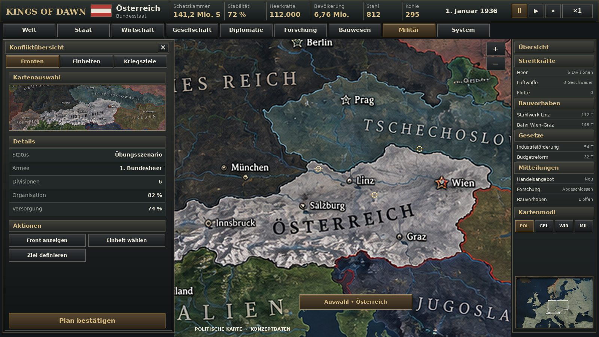

Kriegsziele, formale Kriegserklärung, Fronten, Befehle, Gelände, abstrakte Gefechtsauflösung, Moral, Erschöpfung, Kontrollwechsel und Kriegsfolgen; keine taktische Mikrosimulation nötig.

**Datenmodell:** War, WarGoal, Front, Order, BattleResolution, Occupation

**UI-Mockup-Referenz:** HTML, F-31; Elemente: Frontkarte; Einheiten; Ziele; Versorgung; Konfliktstatus; Waffenstillstand

**Abnahme:** Deterministischer Gefechtsausgang bei gleichem Seed; Kontrolle getrennt von Anspruch; Verluste und Kosten werden verbucht; zivile Auswirkungen modelliert.

**Prompt:**

Setze das Modul 31 – Krieg, Fronten und Konfliktsimulation für KINGS OF DAWN um. Phase: V1. Verwende den globalen Projektauftrag und die gemeinsame Architektur. Nutze die zugehörige High-Fidelity-Referenz als verbindliche visuelle Basis: feste HUD-Positionen, gleiche Kartenkamera, Messingrahmen und dunkle Stahlpanels, seitlicher Outliner, Minikarte, modulspezifische Controls; implementiere skalierbare UMG/Slate-Komponenten, keine bloße Screenshot-Oberfläche. Nutze verbindlich UE5; implementiere die Fachlogik bevorzugt im Rust-Core, die erforderlichen Engine-Adapter in C++ und die Oberfläche in UMG/Slate. Nutze das KingsOfDawnSimulation-Plugin und die versionierte C-ABI mit Commands und Snapshot-/Delta-Queries. Rein präsentationsbezogene Funktionen bleiben in Unreal; dupliziere keine Simulationslogik. Ergänze Rust-Tests und bei UE-Integration Unreal-Automation-Tests. Die Oberfläche und alle ViewModels müssen die definierte Designrichtung "modernes HOI4" einhalten: dunkle Grand-Strategy-Panels, Kartenfokus, obere Statusleisten, Seiteninspektoren, warme Metall-/Goldakzente, hohe Informationsdichte und zugleich modernisierte Lesbarkeit sowie UX. Fachlicher Umfang: Kriegsziele, formale Kriegserklärung, Fronten, Befehle, Gelände, abstrakte Gefechtsauflösung, Moral, Erschöpfung, Kontrollwechsel und Kriegsfolgen; keine taktische Mikrosimulation nötig. Datenmodell: War, WarGoal, Front, Order, BattleResolution, Occupation. Baue die Oberfläche nach dem zugehörigen Mockup mit folgenden Bedienelementen: Frontkarte; Einheiten; Ziele; Versorgung; Konfliktstatus; Waffenstillstand. Abhängigkeiten: 27,29,30,32. Definiere typisierte Commands, read-only Queries, Domain-Events, Validierung, Transaktionen und Fehler-/Leerzustände. Implementiere die Funktion im Simulationskern und verbinde sie mit der UI; keine rein visuellen Platzhalter. Prüfe Epochenregeln, Realismus-/Sandbox-Berechtigungen und Save-Kompatibilität, soweit relevant. Abnahme: Deterministischer Gefechtsausgang bei gleichem Seed; Kontrolle getrennt von Anspruch; Verluste und Kosten werden verbucht; zivile Auswirkungen modelliert. Liefere Unit- und Integrationstests, UI-Smoke-Test, Seed-Fixture, Dokumentation und eine kurze Liste der verbleibenden Einschränkungen. Halte Gefechte auf abstrakter Spielebene; verwende Kapazitäten, Moral und Versorgung, keine realen Angriffsanleitungen.

### F-32 – Nachschub, Transport und Mobilisierung (V1)

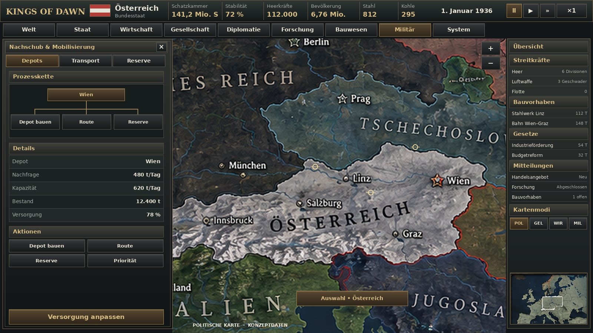

Versorgung aus Depots, Verkehrsnetz, Transportkapazitäten, Wartung, Verpflegung, Treibstoff je Epoche; Mobilisierung und Demobilisierung; aggregierte Materialbilanz.

**Datenmodell:** Depot, SupplyDemand, LogisticsRoute, Mobilization, Maintenance

**UI-Mockup-Referenz:** HTML, F-32; Elemente: Depot; Nachfrage; Kapazität; Versorgungsstatus; Mobilisieren

**Abnahme:** Kein Material aus dem Nichts; unterbrochene Wege senken Versorgung; Mobilisierung belastet Wirtschaft; Demobilisierung gibt Arbeitskräfte zurück.

**Prompt:**

Setze das Modul 32 – Nachschub, Transport und Mobilisierung für KINGS OF DAWN um. Phase: V1. Verwende den globalen Projektauftrag und die gemeinsame Architektur. Nutze die zugehörige High-Fidelity-Referenz als verbindliche visuelle Basis: feste HUD-Positionen, gleiche Kartenkamera, Messingrahmen und dunkle Stahlpanels, seitlicher Outliner, Minikarte, modulspezifische Controls; implementiere skalierbare UMG/Slate-Komponenten, keine bloße Screenshot-Oberfläche. Nutze verbindlich UE5; implementiere die Fachlogik bevorzugt im Rust-Core, die erforderlichen Engine-Adapter in C++ und die Oberfläche in UMG/Slate. Nutze das KingsOfDawnSimulation-Plugin und die versionierte C-ABI mit Commands und Snapshot-/Delta-Queries. Rein präsentationsbezogene Funktionen bleiben in Unreal; dupliziere keine Simulationslogik. Ergänze Rust-Tests und bei UE-Integration Unreal-Automation-Tests. Die Oberfläche und alle ViewModels müssen die definierte Designrichtung "modernes HOI4" einhalten: dunkle Grand-Strategy-Panels, Kartenfokus, obere Statusleisten, Seiteninspektoren, warme Metall-/Goldakzente, hohe Informationsdichte und zugleich modernisierte Lesbarkeit sowie UX. Fachlicher Umfang: Versorgung aus Depots, Verkehrsnetz, Transportkapazitäten, Wartung, Verpflegung, Treibstoff je Epoche; Mobilisierung und Demobilisierung; aggregierte Materialbilanz. Datenmodell: Depot, SupplyDemand, LogisticsRoute, Mobilization, Maintenance. Baue die Oberfläche nach dem zugehörigen Mockup mit folgenden Bedienelementen: Depot; Nachfrage; Kapazität; Versorgungsstatus; Mobilisieren. Abhängigkeiten: 16,22,29. Definiere typisierte Commands, read-only Queries, Domain-Events, Validierung, Transaktionen und Fehler-/Leerzustände. Implementiere die Funktion im Simulationskern und verbinde sie mit der UI; keine rein visuellen Platzhalter. Prüfe Epochenregeln, Realismus-/Sandbox-Berechtigungen und Save-Kompatibilität, soweit relevant. Abnahme: Kein Material aus dem Nichts; unterbrochene Wege senken Versorgung; Mobilisierung belastet Wirtschaft; Demobilisierung gibt Arbeitskräfte zurück. Liefere Unit- und Integrationstests, UI-Smoke-Test, Seed-Fixture, Dokumentation und eine kurze Liste der verbleibenden Einschränkungen. 

### F-33 – Besatzung, Friedenskonferenz und Wiederaufbau (V1)

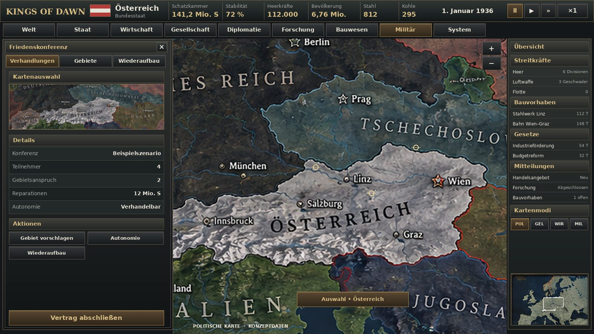

Waffenstillstand, Verhandlungen, Gebietsabtretungen, Autonomie, Reparationen, Gefangenenaustausch abstrakt, Anerkennung, zivile Schäden und Wiederaufbau; getrennte militärische Kontrolle und Souveränität.

**Datenmodell:** PeaceProposal, OccupationPolicy, TerritorialTransfer, Reparations, Reconstruction

**UI-Mockup-Referenz:** HTML, F-33; Elemente: Friedenskonferenz; Gebiet; Reparationen; Autonomie; Vertragsvorschau

**Abnahme:** Annahme atomar überführt Gebiet/Vertrag/Buchhaltung; vorherige Kontrollhistorie erhalten; zivile Kosten bleiben nach Frieden bestehen.

**Prompt:**

Setze das Modul 33 – Besatzung, Friedenskonferenz und Wiederaufbau für KINGS OF DAWN um. Phase: V1. Verwende den globalen Projektauftrag und die gemeinsame Architektur. Nutze die zugehörige High-Fidelity-Referenz als verbindliche visuelle Basis: feste HUD-Positionen, gleiche Kartenkamera, Messingrahmen und dunkle Stahlpanels, seitlicher Outliner, Minikarte, modulspezifische Controls; implementiere skalierbare UMG/Slate-Komponenten, keine bloße Screenshot-Oberfläche. Nutze verbindlich UE5; implementiere die Fachlogik bevorzugt im Rust-Core, die erforderlichen Engine-Adapter in C++ und die Oberfläche in UMG/Slate. Nutze das KingsOfDawnSimulation-Plugin und die versionierte C-ABI mit Commands und Snapshot-/Delta-Queries. Rein präsentationsbezogene Funktionen bleiben in Unreal; dupliziere keine Simulationslogik. Ergänze Rust-Tests und bei UE-Integration Unreal-Automation-Tests. Die Oberfläche und alle ViewModels müssen die definierte Designrichtung "modernes HOI4" einhalten: dunkle Grand-Strategy-Panels, Kartenfokus, obere Statusleisten, Seiteninspektoren, warme Metall-/Goldakzente, hohe Informationsdichte und zugleich modernisierte Lesbarkeit sowie UX. Fachlicher Umfang: Waffenstillstand, Verhandlungen, Gebietsabtretungen, Autonomie, Reparationen, Gefangenenaustausch abstrakt, Anerkennung, zivile Schäden und Wiederaufbau; getrennte militärische Kontrolle und Souveränität. Datenmodell: PeaceProposal, OccupationPolicy, TerritorialTransfer, Reparations, Reconstruction. Baue die Oberfläche nach dem zugehörigen Mockup mit folgenden Bedienelementen: Friedenskonferenz; Gebiet; Reparationen; Autonomie; Vertragsvorschau. Abhängigkeiten: 27,28,31. Definiere typisierte Commands, read-only Queries, Domain-Events, Validierung, Transaktionen und Fehler-/Leerzustände. Implementiere die Funktion im Simulationskern und verbinde sie mit der UI; keine rein visuellen Platzhalter. Prüfe Epochenregeln, Realismus-/Sandbox-Berechtigungen und Save-Kompatibilität, soweit relevant. Abnahme: Annahme atomar überführt Gebiet/Vertrag/Buchhaltung; vorherige Kontrollhistorie erhalten; zivile Kosten bleiben nach Frieden bestehen. Liefere Unit- und Integrationstests, UI-Smoke-Test, Seed-Fixture, Dokumentation und eine kurze Liste der verbleibenden Einschränkungen. 

### F-34 – Nachrichtendienste und Informationslage (V1)

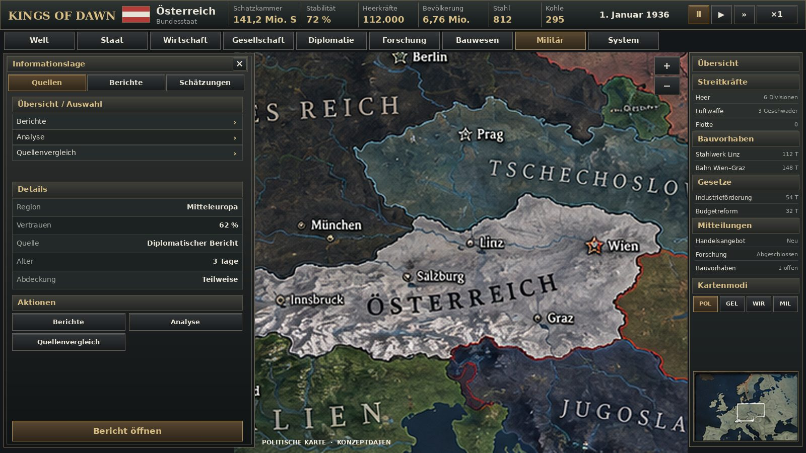

Abstrakte Auslandsaufklärung, Gegenaufklärung, Informationsgüte, diplomatische Risiken und unvollständige Sicht auf fremde Staaten; keine realen Anleitungen.

**Datenmodell:** IntelAgency, IntelEstimate, Confidence, DiscoveryEvent

**UI-Mockup-Referenz:** HTML, F-34; Elemente: Informationslage; Schätzung; Quelle; Vertrauen; Budget

**Abnahme:** Schätzungen können von tatsächlichen Daten abweichen; Spieler sieht Unsicherheit; Kosten und Entdeckungsrisiko werden simuliert.

**Prompt:**

Setze das Modul 34 – Nachrichtendienste und Informationslage für KINGS OF DAWN um. Phase: V1. Verwende den globalen Projektauftrag und die gemeinsame Architektur. Nutze die zugehörige High-Fidelity-Referenz als verbindliche visuelle Basis: feste HUD-Positionen, gleiche Kartenkamera, Messingrahmen und dunkle Stahlpanels, seitlicher Outliner, Minikarte, modulspezifische Controls; implementiere skalierbare UMG/Slate-Komponenten, keine bloße Screenshot-Oberfläche. Nutze verbindlich UE5; implementiere die Fachlogik bevorzugt im Rust-Core, die erforderlichen Engine-Adapter in C++ und die Oberfläche in UMG/Slate. Nutze das KingsOfDawnSimulation-Plugin und die versionierte C-ABI mit Commands und Snapshot-/Delta-Queries. Rein präsentationsbezogene Funktionen bleiben in Unreal; dupliziere keine Simulationslogik. Ergänze Rust-Tests und bei UE-Integration Unreal-Automation-Tests. Die Oberfläche und alle ViewModels müssen die definierte Designrichtung "modernes HOI4" einhalten: dunkle Grand-Strategy-Panels, Kartenfokus, obere Statusleisten, Seiteninspektoren, warme Metall-/Goldakzente, hohe Informationsdichte und zugleich modernisierte Lesbarkeit sowie UX. Fachlicher Umfang: Abstrakte Auslandsaufklärung, Gegenaufklärung, Informationsgüte, diplomatische Risiken und unvollständige Sicht auf fremde Staaten; keine realen Anleitungen. Datenmodell: IntelAgency, IntelEstimate, Confidence, DiscoveryEvent. Baue die Oberfläche nach dem zugehörigen Mockup mit folgenden Bedienelementen: Informationslage; Schätzung; Quelle; Vertrauen; Budget. Abhängigkeiten: 12,27. Definiere typisierte Commands, read-only Queries, Domain-Events, Validierung, Transaktionen und Fehler-/Leerzustände. Implementiere die Funktion im Simulationskern und verbinde sie mit der UI; keine rein visuellen Platzhalter. Prüfe Epochenregeln, Realismus-/Sandbox-Berechtigungen und Save-Kompatibilität, soweit relevant. Abnahme: Schätzungen können von tatsächlichen Daten abweichen; Spieler sieht Unsicherheit; Kosten und Entdeckungsrisiko werden simuliert. Liefere Unit- und Integrationstests, UI-Smoke-Test, Seed-Fixture, Dokumentation und eine kurze Liste der verbleibenden Einschränkungen. 

### F-35 – Autonome KI und Entscheidungssystem (MVP)

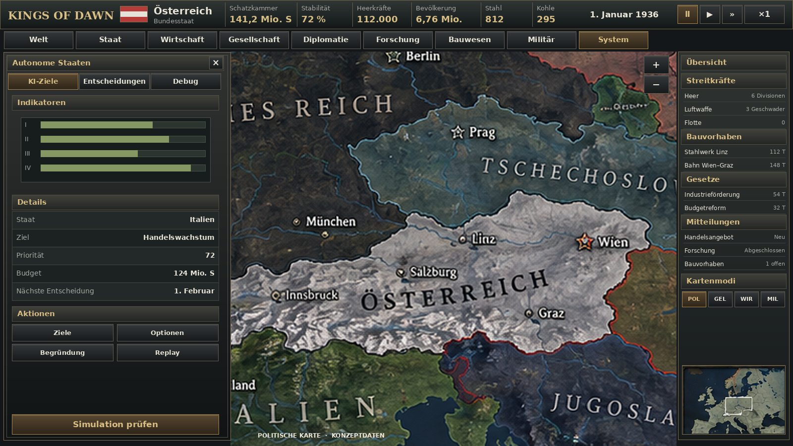

KI-Staaten verwalten Budget, bauen, handeln, reformieren und verhandeln anhand Zielen, begrenztem Wissen, Nutzen und Zwängen; Charakter-KI für Ämter und Beziehungen; keine omniscienten Aktionen.

**Datenmodell:** Agent, Goal, UtilityScore, Decision, Plan, KnowledgeState

**UI-Mockup-Referenz:** HTML, F-35; Elemente: KI-Ziele; Aktionen; Begründung; Budget; Simulationsprotokoll

**Abnahme:** KI verwendet dieselben Commands und Ressourcenregeln wie Spieler; reproduzierbare Entscheidungen; 20 Teststaaten bleiben über 100 Jahre simulierbar.

**Prompt:**

Setze das Modul 35 – Autonome KI und Entscheidungssystem für KINGS OF DAWN um. Phase: MVP. Verwende den globalen Projektauftrag und die gemeinsame Architektur. Nutze die zugehörige High-Fidelity-Referenz als verbindliche visuelle Basis: feste HUD-Positionen, gleiche Kartenkamera, Messingrahmen und dunkle Stahlpanels, seitlicher Outliner, Minikarte, modulspezifische Controls; implementiere skalierbare UMG/Slate-Komponenten, keine bloße Screenshot-Oberfläche. Nutze verbindlich UE5; implementiere die Fachlogik bevorzugt im Rust-Core, die erforderlichen Engine-Adapter in C++ und die Oberfläche in UMG/Slate. Nutze das KingsOfDawnSimulation-Plugin und die versionierte C-ABI mit Commands und Snapshot-/Delta-Queries. Rein präsentationsbezogene Funktionen bleiben in Unreal; dupliziere keine Simulationslogik. Ergänze Rust-Tests und bei UE-Integration Unreal-Automation-Tests. Die Oberfläche und alle ViewModels müssen die definierte Designrichtung "modernes HOI4" einhalten: dunkle Grand-Strategy-Panels, Kartenfokus, obere Statusleisten, Seiteninspektoren, warme Metall-/Goldakzente, hohe Informationsdichte und zugleich modernisierte Lesbarkeit sowie UX. Fachlicher Umfang: KI-Staaten verwalten Budget, bauen, handeln, reformieren und verhandeln anhand Zielen, begrenztem Wissen, Nutzen und Zwängen; Charakter-KI für Ämter und Beziehungen; keine omniscienten Aktionen. Datenmodell: Agent, Goal, UtilityScore, Decision, Plan, KnowledgeState. Baue die Oberfläche nach dem zugehörigen Mockup mit folgenden Bedienelementen: KI-Ziele; Aktionen; Begründung; Budget; Simulationsprotokoll. Abhängigkeiten: 05,12,15,16,19,27. Definiere typisierte Commands, read-only Queries, Domain-Events, Validierung, Transaktionen und Fehler-/Leerzustände. Implementiere die Funktion im Simulationskern und verbinde sie mit der UI; keine rein visuellen Platzhalter. Prüfe Epochenregeln, Realismus-/Sandbox-Berechtigungen und Save-Kompatibilität, soweit relevant. Abnahme: KI verwendet dieselben Commands und Ressourcenregeln wie Spieler; reproduzierbare Entscheidungen; 20 Teststaaten bleiben über 100 Jahre simulierbar. Liefere Unit- und Integrationstests, UI-Smoke-Test, Seed-Fixture, Dokumentation und eine kurze Liste der verbleibenden Einschränkungen. Nutze reproduzierbare Utility-Scoring-KI mit begrenztem Entscheidungsbudget und erklärbaren Prioritäten; teste autonomen Langzeitlauf.

### F-36 – Ereignisse, Missionen und Szenarioeditor (V1)

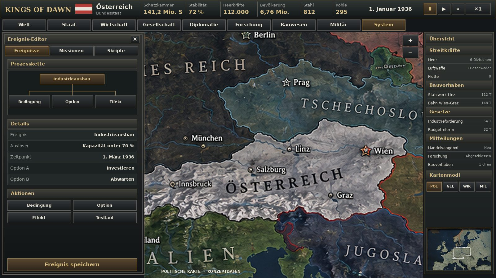

Eigene Events mit Triggern, Bedingungen, Optionen, Wahrscheinlichkeiten, Folgen, Missionszielen und Zeitfenstern; historisch mögliche, nicht erzwungene Ereignisse; visuelle Regeln ohne beliebige Codeausführung.

**Datenmodell:** EventDefinition, Trigger, Condition, Effect, Mission, ScenarioPatch

**UI-Mockup-Referenz:** HTML, F-36; Elemente: Wenn-Bedingung; Optionen; Folge; Zeitpunkt; Test ausführen

**Abnahme:** DSL validiert Referenzen; Trigger feuern nach Regeln, nicht mehrfach ungewollt; Ereignisse lassen sich deterministisch testen.

**Prompt:**

Setze das Modul 36 – Ereignisse, Missionen und Szenarioeditor für KINGS OF DAWN um. Phase: V1. Verwende den globalen Projektauftrag und die gemeinsame Architektur. Nutze die zugehörige High-Fidelity-Referenz als verbindliche visuelle Basis: feste HUD-Positionen, gleiche Kartenkamera, Messingrahmen und dunkle Stahlpanels, seitlicher Outliner, Minikarte, modulspezifische Controls; implementiere skalierbare UMG/Slate-Komponenten, keine bloße Screenshot-Oberfläche. Nutze verbindlich UE5; implementiere die Fachlogik bevorzugt im Rust-Core, die erforderlichen Engine-Adapter in C++ und die Oberfläche in UMG/Slate. Nutze das KingsOfDawnSimulation-Plugin und die versionierte C-ABI mit Commands und Snapshot-/Delta-Queries. Rein präsentationsbezogene Funktionen bleiben in Unreal; dupliziere keine Simulationslogik. Ergänze Rust-Tests und bei UE-Integration Unreal-Automation-Tests. Die Oberfläche und alle ViewModels müssen die definierte Designrichtung "modernes HOI4" einhalten: dunkle Grand-Strategy-Panels, Kartenfokus, obere Statusleisten, Seiteninspektoren, warme Metall-/Goldakzente, hohe Informationsdichte und zugleich modernisierte Lesbarkeit sowie UX. Fachlicher Umfang: Eigene Events mit Triggern, Bedingungen, Optionen, Wahrscheinlichkeiten, Folgen, Missionszielen und Zeitfenstern; historisch mögliche, nicht erzwungene Ereignisse; visuelle Regeln ohne beliebige Codeausführung. Datenmodell: EventDefinition, Trigger, Condition, Effect, Mission, ScenarioPatch. Baue die Oberfläche nach dem zugehörigen Mockup mit folgenden Bedienelementen: Wenn-Bedingung; Optionen; Folge; Zeitpunkt; Test ausführen. Abhängigkeiten: 01,10,35. Definiere typisierte Commands, read-only Queries, Domain-Events, Validierung, Transaktionen und Fehler-/Leerzustände. Implementiere die Funktion im Simulationskern und verbinde sie mit der UI; keine rein visuellen Platzhalter. Prüfe Epochenregeln, Realismus-/Sandbox-Berechtigungen und Save-Kompatibilität, soweit relevant. Abnahme: DSL validiert Referenzen; Trigger feuern nach Regeln, nicht mehrfach ungewollt; Ereignisse lassen sich deterministisch testen. Liefere Unit- und Integrationstests, UI-Smoke-Test, Seed-Fixture, Dokumentation und eine kurze Liste der verbleibenden Einschränkungen. 

### F-37 – Zeitung, Chronik und Geschichtsarchiv (V1)

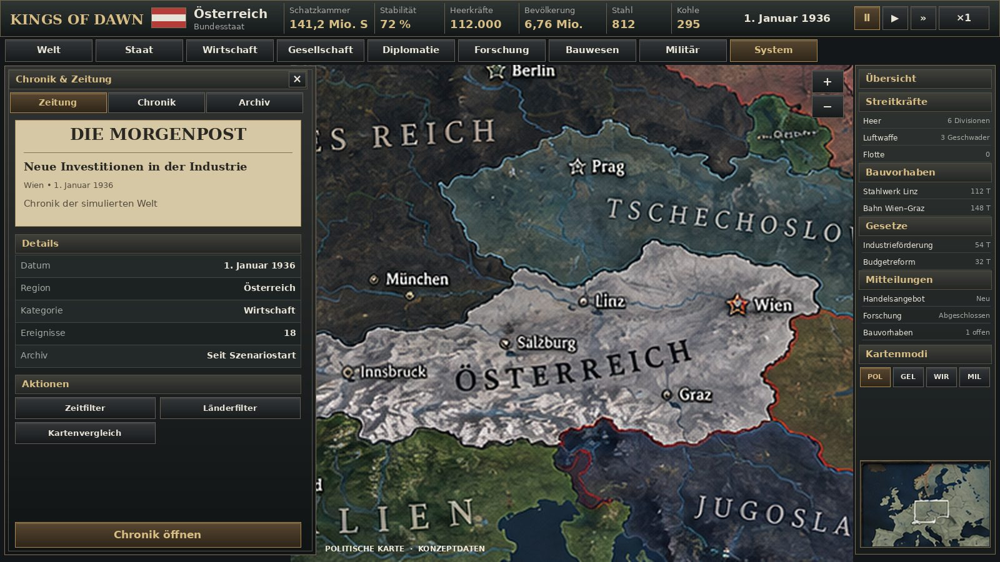

Automatisch generierte Nachrichten aus tatsächlichen Domain-Events, Jahresrückblicke, Herrscherlisten, Kartenvergleich, statistische Zeitreihen und Biografien; Quellen für historische Initialdaten.

**Datenmodell:** DomainEvent, NewsArticle, TimelineEntry, HistorySnapshot

**UI-Mockup-Referenz:** HTML, F-37; Elemente: Chronik; Filter; Zeitung; Kartenvergleich; Jahresbericht

**Abnahme:** Jede Nachricht verlinkt reales Spielereignis; keine frei erfundenen Simulationsfakten; historische und alternative Ereignisse klar getrennt.

**Prompt:**

Setze das Modul 37 – Zeitung, Chronik und Geschichtsarchiv für KINGS OF DAWN um. Phase: V1. Verwende den globalen Projektauftrag und die gemeinsame Architektur. Nutze die zugehörige High-Fidelity-Referenz als verbindliche visuelle Basis: feste HUD-Positionen, gleiche Kartenkamera, Messingrahmen und dunkle Stahlpanels, seitlicher Outliner, Minikarte, modulspezifische Controls; implementiere skalierbare UMG/Slate-Komponenten, keine bloße Screenshot-Oberfläche. Nutze verbindlich UE5; implementiere die Fachlogik bevorzugt im Rust-Core, die erforderlichen Engine-Adapter in C++ und die Oberfläche in UMG/Slate. Nutze das KingsOfDawnSimulation-Plugin und die versionierte C-ABI mit Commands und Snapshot-/Delta-Queries. Rein präsentationsbezogene Funktionen bleiben in Unreal; dupliziere keine Simulationslogik. Ergänze Rust-Tests und bei UE-Integration Unreal-Automation-Tests. Die Oberfläche und alle ViewModels müssen die definierte Designrichtung "modernes HOI4" einhalten: dunkle Grand-Strategy-Panels, Kartenfokus, obere Statusleisten, Seiteninspektoren, warme Metall-/Goldakzente, hohe Informationsdichte und zugleich modernisierte Lesbarkeit sowie UX. Fachlicher Umfang: Automatisch generierte Nachrichten aus tatsächlichen Domain-Events, Jahresrückblicke, Herrscherlisten, Kartenvergleich, statistische Zeitreihen und Biografien; Quellen für historische Initialdaten. Datenmodell: DomainEvent, NewsArticle, TimelineEntry, HistorySnapshot. Baue die Oberfläche nach dem zugehörigen Mockup mit folgenden Bedienelementen: Chronik; Filter; Zeitung; Kartenvergleich; Jahresbericht. Abhängigkeiten: 01,08,35,36. Definiere typisierte Commands, read-only Queries, Domain-Events, Validierung, Transaktionen und Fehler-/Leerzustände. Implementiere die Funktion im Simulationskern und verbinde sie mit der UI; keine rein visuellen Platzhalter. Prüfe Epochenregeln, Realismus-/Sandbox-Berechtigungen und Save-Kompatibilität, soweit relevant. Abnahme: Jede Nachricht verlinkt reales Spielereignis; keine frei erfundenen Simulationsfakten; historische und alternative Ereignisse klar getrennt. Liefere Unit- und Integrationstests, UI-Smoke-Test, Seed-Fixture, Dokumentation und eine kurze Liste der verbleibenden Einschränkungen. 

### F-38 – Statistiken, Ranglisten und Analyse (MVP)

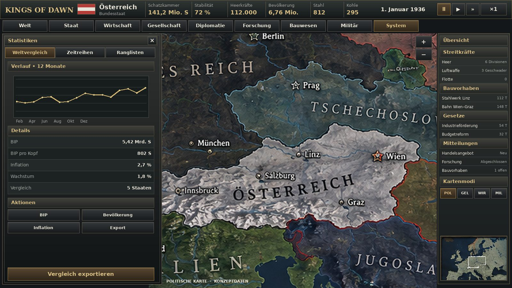

Dashboards zu Bevölkerung, Produktion, Budget, Handel, Gesundheit, Bildung, Militär und Umwelt; nominal/real, pro Kopf, vergleichbare Einheiten, Zeitreihen, Export und Einflussfaktoren.

**Datenmodell:** MetricDefinition, Observation, Series, Comparison, ExportJob

**UI-Mockup-Referenz:** HTML, F-38; Elemente: BIP; pro Kopf; Inflation; Vergleichsländer; Zeitraum; CSV

**Abnahme:** Metriken aus Domain-Daten berechnet; Summen stimmen; fehlende Werte als unbekannt statt Null; Zeitreihen und Export identisch.

**Prompt:**

Setze das Modul 38 – Statistiken, Ranglisten und Analyse für KINGS OF DAWN um. Phase: MVP. Verwende den globalen Projektauftrag und die gemeinsame Architektur. Nutze die zugehörige High-Fidelity-Referenz als verbindliche visuelle Basis: feste HUD-Positionen, gleiche Kartenkamera, Messingrahmen und dunkle Stahlpanels, seitlicher Outliner, Minikarte, modulspezifische Controls; implementiere skalierbare UMG/Slate-Komponenten, keine bloße Screenshot-Oberfläche. Nutze verbindlich UE5; implementiere die Fachlogik bevorzugt im Rust-Core, die erforderlichen Engine-Adapter in C++ und die Oberfläche in UMG/Slate. Nutze das KingsOfDawnSimulation-Plugin und die versionierte C-ABI mit Commands und Snapshot-/Delta-Queries. Rein präsentationsbezogene Funktionen bleiben in Unreal; dupliziere keine Simulationslogik. Ergänze Rust-Tests und bei UE-Integration Unreal-Automation-Tests. Die Oberfläche und alle ViewModels müssen die definierte Designrichtung "modernes HOI4" einhalten: dunkle Grand-Strategy-Panels, Kartenfokus, obere Statusleisten, Seiteninspektoren, warme Metall-/Goldakzente, hohe Informationsdichte und zugleich modernisierte Lesbarkeit sowie UX. Fachlicher Umfang: Dashboards zu Bevölkerung, Produktion, Budget, Handel, Gesundheit, Bildung, Militär und Umwelt; nominal/real, pro Kopf, vergleichbare Einheiten, Zeitreihen, Export und Einflussfaktoren. Datenmodell: MetricDefinition, Observation, Series, Comparison, ExportJob. Baue die Oberfläche nach dem zugehörigen Mockup mit folgenden Bedienelementen: BIP; pro Kopf; Inflation; Vergleichsländer; Zeitraum; CSV. Abhängigkeiten: 14,15,16,19. Definiere typisierte Commands, read-only Queries, Domain-Events, Validierung, Transaktionen und Fehler-/Leerzustände. Implementiere die Funktion im Simulationskern und verbinde sie mit der UI; keine rein visuellen Platzhalter. Prüfe Epochenregeln, Realismus-/Sandbox-Berechtigungen und Save-Kompatibilität, soweit relevant. Abnahme: Metriken aus Domain-Daten berechnet; Summen stimmen; fehlende Werte als unbekannt statt Null; Zeitreihen und Export identisch. Liefere Unit- und Integrationstests, UI-Smoke-Test, Seed-Fixture, Dokumentation und eine kurze Liste der verbleibenden Einschränkungen. 

### F-39 – Spielmodi, Zeitsteuerung und Speichern (MVP)

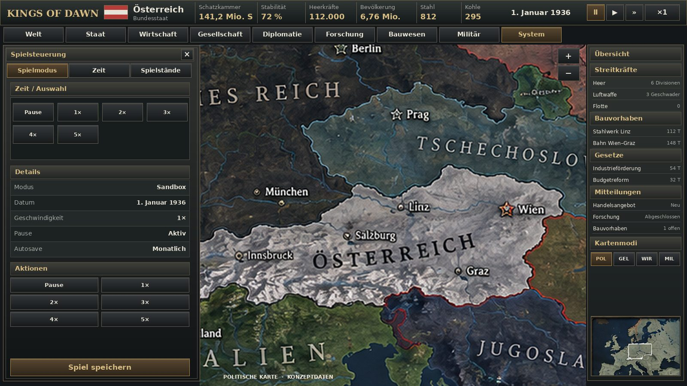

Pausierbare Echtzeit, 1–5 Geschwindigkeiten, Datumssprung nur in Sandbox, Realismus-/Komplexitätsstufen, Beobachtermodus, Autosaves, manuelle Saves, Fork und Replay; keine feste Endzeit.

**Datenmodell:** GameClock, RuleSet, SaveManifest, Snapshot, CommandLog

**UI-Mockup-Referenz:** HTML, F-39; Elemente: Pause; Geschwindigkeit; Datum; Speichern; Beobachter; Replay

**Abnahme:** Gleicher Save+Commands erzeugen gleichen Hash; Restore setzt exakt fort; kein Sprung über Jahr Null; kaputte Save-Datei wird erkannt.

**Prompt:**

Setze das Modul 39 – Spielmodi, Zeitsteuerung und Speichern für KINGS OF DAWN um. Phase: MVP. Verwende den globalen Projektauftrag und die gemeinsame Architektur. Nutze die zugehörige High-Fidelity-Referenz als verbindliche visuelle Basis: feste HUD-Positionen, gleiche Kartenkamera, Messingrahmen und dunkle Stahlpanels, seitlicher Outliner, Minikarte, modulspezifische Controls; implementiere skalierbare UMG/Slate-Komponenten, keine bloße Screenshot-Oberfläche. Nutze verbindlich UE5; implementiere die Fachlogik bevorzugt im Rust-Core, die erforderlichen Engine-Adapter in C++ und die Oberfläche in UMG/Slate. Nutze das KingsOfDawnSimulation-Plugin und die versionierte C-ABI mit Commands und Snapshot-/Delta-Queries. Rein präsentationsbezogene Funktionen bleiben in Unreal; dupliziere keine Simulationslogik. Ergänze Rust-Tests und bei UE-Integration Unreal-Automation-Tests. Die Oberfläche und alle ViewModels müssen die definierte Designrichtung "modernes HOI4" einhalten: dunkle Grand-Strategy-Panels, Kartenfokus, obere Statusleisten, Seiteninspektoren, warme Metall-/Goldakzente, hohe Informationsdichte und zugleich modernisierte Lesbarkeit sowie UX. Fachlicher Umfang: Pausierbare Echtzeit, 1–5 Geschwindigkeiten, Datumssprung nur in Sandbox, Realismus-/Komplexitätsstufen, Beobachtermodus, Autosaves, manuelle Saves, Fork und Replay; keine feste Endzeit. Datenmodell: GameClock, RuleSet, SaveManifest, Snapshot, CommandLog. Baue die Oberfläche nach dem zugehörigen Mockup mit folgenden Bedienelementen: Pause; Geschwindigkeit; Datum; Speichern; Beobachter; Replay. Abhängigkeiten: 01,35. Definiere typisierte Commands, read-only Queries, Domain-Events, Validierung, Transaktionen und Fehler-/Leerzustände. Implementiere die Funktion im Simulationskern und verbinde sie mit der UI; keine rein visuellen Platzhalter. Prüfe Epochenregeln, Realismus-/Sandbox-Berechtigungen und Save-Kompatibilität, soweit relevant. Abnahme: Gleicher Save+Commands erzeugen gleichen Hash; Restore setzt exakt fort; kein Sprung über Jahr Null; kaputte Save-Datei wird erkannt. Liefere Unit- und Integrationstests, UI-Smoke-Test, Seed-Fixture, Dokumentation und eine kurze Liste der verbleibenden Einschränkungen. Implementiere snapshot + command log, schema migrations, state hashing und atomare Dateiersetzung.

### F-40 – Modding und benutzerdefinierte Inhalte (V1)

Modpakete für Szenarien, Karten, Gesetze, Technologien, Kulturen, Symbole, Events und Regeln; Manifest, Abhängigkeiten, Priorität, Schema-Versionen, Konflikte, lokaler Import/Export.

**Datenmodell:** ModManifest, ContentPack, Dependency, Patch, ValidationReport

**UI-Mockup-Referenz:** HTML, F-40; Elemente: Modliste; Ladefolge; Konflikt; Validierung; Importieren

**Abnahme:** Ungültige oder unsichere Inhalte isoliert; fehlende Abhängigkeiten sichtbar; Save bindet Modversionen; deaktivierter Mod ändert Basispaket nicht.

**Prompt:**

Setze das Modul 40 – Modding und benutzerdefinierte Inhalte für KINGS OF DAWN um. Phase: V1. Verwende den globalen Projektauftrag und die gemeinsame Architektur. Nutze die zugehörige High-Fidelity-Referenz als verbindliche visuelle Basis: feste HUD-Positionen, gleiche Kartenkamera, Messingrahmen und dunkle Stahlpanels, seitlicher Outliner, Minikarte, modulspezifische Controls; implementiere skalierbare UMG/Slate-Komponenten, keine bloße Screenshot-Oberfläche. Nutze verbindlich UE5; implementiere die Fachlogik bevorzugt im Rust-Core, die erforderlichen Engine-Adapter in C++ und die Oberfläche in UMG/Slate. Nutze das KingsOfDawnSimulation-Plugin und die versionierte C-ABI mit Commands und Snapshot-/Delta-Queries. Rein präsentationsbezogene Funktionen bleiben in Unreal; dupliziere keine Simulationslogik. Ergänze Rust-Tests und bei UE-Integration Unreal-Automation-Tests. Die Oberfläche und alle ViewModels müssen die definierte Designrichtung "modernes HOI4" einhalten: dunkle Grand-Strategy-Panels, Kartenfokus, obere Statusleisten, Seiteninspektoren, warme Metall-/Goldakzente, hohe Informationsdichte und zugleich modernisierte Lesbarkeit sowie UX. Fachlicher Umfang: Modpakete für Szenarien, Karten, Gesetze, Technologien, Kulturen, Symbole, Events und Regeln; Manifest, Abhängigkeiten, Priorität, Schema-Versionen, Konflikte, lokaler Import/Export. Datenmodell: ModManifest, ContentPack, Dependency, Patch, ValidationReport. Baue die Oberfläche nach dem zugehörigen Mockup mit folgenden Bedienelementen: Modliste; Ladefolge; Konflikt; Validierung; Importieren. Abhängigkeiten: 02,36,39. Definiere typisierte Commands, read-only Queries, Domain-Events, Validierung, Transaktionen und Fehler-/Leerzustände. Implementiere die Funktion im Simulationskern und verbinde sie mit der UI; keine rein visuellen Platzhalter. Prüfe Epochenregeln, Realismus-/Sandbox-Berechtigungen und Save-Kompatibilität, soweit relevant. Abnahme: Ungültige oder unsichere Inhalte isoliert; fehlende Abhängigkeiten sichtbar; Save bindet Modversionen; deaktivierter Mod ändert Basispaket nicht. Liefere Unit- und Integrationstests, UI-Smoke-Test, Seed-Fixture, Dokumentation und eine kurze Liste der verbleibenden Einschränkungen. Sandbox für Regeldefinitionen, Asset-Prüfung, deklarative Patches und deterministische Load-Order.

### F-41 – Multiplayer und Rollenverwaltung (V2)

Host-basierte autoritative Simulation, Lobbys, Rollen pro Land/Institution, Sichtrechte, synchrone Commands, Pauseabstimmung, Reconnect, Save und Desync-Diagnose.

**Datenmodell:** Session, PlayerRole, CommandEnvelope, Permission, StateHash

**UI-Mockup-Referenz:** HTML, F-41; Elemente: Lobby; Spieler; Land/Rolle; Ping; Bereit; Pausevote

**Abnahme:** Unautorisierte Commands abgelehnt; Reconnect ohne Zustandsverlust; Hash-Abweichung erkannt; Multiplayer-Save reproduzierbar.

**Prompt:**

Setze das Modul 41 – Multiplayer und Rollenverwaltung für KINGS OF DAWN um. Phase: V2. Verwende den globalen Projektauftrag und die gemeinsame Architektur. Nutze die zugehörige High-Fidelity-Referenz als verbindliche visuelle Basis: feste HUD-Positionen, gleiche Kartenkamera, Messingrahmen und dunkle Stahlpanels, seitlicher Outliner, Minikarte, modulspezifische Controls; implementiere skalierbare UMG/Slate-Komponenten, keine bloße Screenshot-Oberfläche. Nutze verbindlich UE5; implementiere die Fachlogik bevorzugt im Rust-Core, die erforderlichen Engine-Adapter in C++ und die Oberfläche in UMG/Slate. Nutze das KingsOfDawnSimulation-Plugin und die versionierte C-ABI mit Commands und Snapshot-/Delta-Queries. Rein präsentationsbezogene Funktionen bleiben in Unreal; dupliziere keine Simulationslogik. Ergänze Rust-Tests und bei UE-Integration Unreal-Automation-Tests. Die Oberfläche und alle ViewModels müssen die definierte Designrichtung "modernes HOI4" einhalten: dunkle Grand-Strategy-Panels, Kartenfokus, obere Statusleisten, Seiteninspektoren, warme Metall-/Goldakzente, hohe Informationsdichte und zugleich modernisierte Lesbarkeit sowie UX. Fachlicher Umfang: Host-basierte autoritative Simulation, Lobbys, Rollen pro Land/Institution, Sichtrechte, synchrone Commands, Pauseabstimmung, Reconnect, Save und Desync-Diagnose. Datenmodell: Session, PlayerRole, CommandEnvelope, Permission, StateHash. Baue die Oberfläche nach dem zugehörigen Mockup mit folgenden Bedienelementen: Lobby; Spieler; Land/Rolle; Ping; Bereit; Pausevote. Abhängigkeiten: 35,39,40. Definiere typisierte Commands, read-only Queries, Domain-Events, Validierung, Transaktionen und Fehler-/Leerzustände. Implementiere die Funktion im Simulationskern und verbinde sie mit der UI; keine rein visuellen Platzhalter. Prüfe Epochenregeln, Realismus-/Sandbox-Berechtigungen und Save-Kompatibilität, soweit relevant. Abnahme: Unautorisierte Commands abgelehnt; Reconnect ohne Zustandsverlust; Hash-Abweichung erkannt; Multiplayer-Save reproduzierbar. Liefere Unit- und Integrationstests, UI-Smoke-Test, Seed-Fixture, Dokumentation und eine kurze Liste der verbleibenden Einschränkungen. Host validiert Berechtigung, Tick und Sequenz; teste Paketverlust, doppelte Commands, Desync und Reconnect.

### F-42 – UX, Einstellungen und Onboarding (MVP)

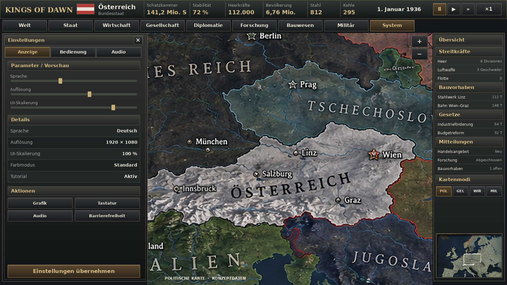

Globales Command Center, Kontextinspektor, Suche, Tastaturkürzel, Tooltips, Tutorial, Barrierefreiheit, Farbblindmodi, Lokalisierung, einstellbare Dichte, Benachrichtigungen und Performanceoptionen.

**Datenmodell:** UserPreference, TutorialStep, Notification, Shortcut, Locale

**UI-Mockup-Referenz:** HTML, F-42; Elemente: Sprache; UI-Skalierung; Farbmodus; Tutorial; Warnungen; Shortcuts

**Abnahme:** Tastaturbedienung der Hauptabläufe; Kontrast geprüft; 1080p und 1440p ohne Überlappung; Einstellungen persistent; Zahlen lokalisiert.

**Prompt:**

Setze das Modul 42 – UX, Einstellungen und Onboarding für KINGS OF DAWN um. Phase: MVP. Verwende den globalen Projektauftrag und die gemeinsame Architektur. Nutze die zugehörige High-Fidelity-Referenz als verbindliche visuelle Basis: feste HUD-Positionen, gleiche Kartenkamera, Messingrahmen und dunkle Stahlpanels, seitlicher Outliner, Minikarte, modulspezifische Controls; implementiere skalierbare UMG/Slate-Komponenten, keine bloße Screenshot-Oberfläche. Nutze verbindlich UE5; implementiere die Fachlogik bevorzugt im Rust-Core, die erforderlichen Engine-Adapter in C++ und die Oberfläche in UMG/Slate. Nutze das KingsOfDawnSimulation-Plugin und die versionierte C-ABI mit Commands und Snapshot-/Delta-Queries. Rein präsentationsbezogene Funktionen bleiben in Unreal; dupliziere keine Simulationslogik. Ergänze Rust-Tests und bei UE-Integration Unreal-Automation-Tests. Die Oberfläche und alle ViewModels müssen die definierte Designrichtung "modernes HOI4" einhalten: dunkle Grand-Strategy-Panels, Kartenfokus, obere Statusleisten, Seiteninspektoren, warme Metall-/Goldakzente, hohe Informationsdichte und zugleich modernisierte Lesbarkeit sowie UX. Fachlicher Umfang: Globales Command Center, Kontextinspektor, Suche, Tastaturkürzel, Tooltips, Tutorial, Barrierefreiheit, Farbblindmodi, Lokalisierung, einstellbare Dichte, Benachrichtigungen und Performanceoptionen. Datenmodell: UserPreference, TutorialStep, Notification, Shortcut, Locale. Baue die Oberfläche nach dem zugehörigen Mockup mit folgenden Bedienelementen: Sprache; UI-Skalierung; Farbmodus; Tutorial; Warnungen; Shortcuts. Abhängigkeiten: 03,39. Definiere typisierte Commands, read-only Queries, Domain-Events, Validierung, Transaktionen und Fehler-/Leerzustände. Implementiere die Funktion im Simulationskern und verbinde sie mit der UI; keine rein visuellen Platzhalter. Prüfe Epochenregeln, Realismus-/Sandbox-Berechtigungen und Save-Kompatibilität, soweit relevant. Abnahme: Tastaturbedienung der Hauptabläufe; Kontrast geprüft; 1080p und 1440p ohne Überlappung; Einstellungen persistent; Zahlen lokalisiert. Liefere Unit- und Integrationstests, UI-Smoke-Test, Seed-Fixture, Dokumentation und eine kurze Liste der verbleibenden Einschränkungen. 
